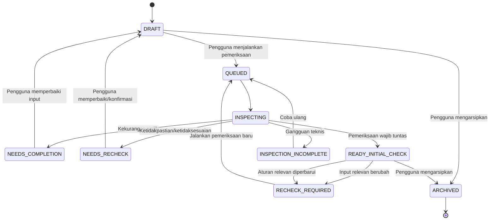

# Business Rules — JejakMasWowo

- **Versi:** 1.0
- **Status:** Baseline aturan bisnis berdasarkan PRD
- **Sumber utama:** `PRD-JejakMasWowo.md`, terutama Bagian 3–5, 7–10, 15–19, 21, dan 24
- **Tujuan:** Menjadi acuan konsisten untuk implementasi Backend (BE), Frontend (FE), QA, dan pengelolaan produk.
- **Catatan:** Aturan yang bersumber dari PRD dipisahkan dari keputusan teknis yang belum final. Jangan menganggap usulan teknis sebagai keputusan produk yang telah disahkan.

> Prinsip utama: JejakMasWowo membantu warga memahami layanan, menyiapkan berkas, melakukan pemeriksaan awal, mencatat pengajuan, dan mengikuti perkembangan sesuai sumber yang tersedia. Sistem bukan pengganti instansi pemerintah, hasil AI bukan keputusan resmi, dan integrasi pemerintah tidak diasumsikan tersedia.

## Daftar isi

1. [Istilah dan prinsip dasar](#1-istilah-dan-prinsip-dasar)
2. [Peran dan hak akses](#2-peran-dan-hak-akses)
3. [Aturan katalog dan panduan layanan](#3-aturan-katalog-dan-panduan-layanan)
4. [Aturan autentikasi dan sesi](#4-aturan-autentikasi-dan-sesi)
5. [Aturan persiapan dan formulir](#5-aturan-persiapan-dan-formulir)
6. [Aturan unggah dan pengelolaan dokumen](#6-aturan-unggah-dan-pengelolaan-dokumen)
7. [Aturan pemeriksaan AI](#7-aturan-pemeriksaan-ai)
8. [Aturan temuan dan koreksi](#8-aturan-temuan-dan-koreksi)
9. [Aturan status persiapan](#9-aturan-status-persiapan)
10. [Aturan pencatatan dan pelacakan pengajuan](#10-aturan-pencatatan-dan-pelacakan-pengajuan)
11. [Aturan petugas dan admin](#11-aturan-petugas-dan-admin)
12. [Aturan chatbot](#12-aturan-chatbot)
13. [Aturan notifikasi dan pengingat](#13-aturan-notifikasi-dan-pengingat)
14. [Privasi, retensi, dan audit](#14-privasi-retensi-dan-audit)
15. [Aturan kegagalan dan pemulihan](#15-aturan-kegagalan-dan-pemulihan)
16. [Konstanta dan domain status](#16-konstanta-dan-domain-status)
17. [Acceptance criteria dan skenario uji](#17-acceptance-criteria-dan-skenario-uji)
18. [Keputusan yang belum final](#18-keputusan-yang-belum-final)

## 1. Istilah dan prinsip dasar

### 1.1 Istilah

| Istilah | Definisi bisnis |
|---|---|
| Pengunjung | Pengguna yang belum masuk akun; dapat mengakses informasi publik. |
| Warga | Pengguna terautentikasi yang mengelola persiapan dan pengajuan miliknya. |
| Petugas | Pengguna berwenang yang hanya mengelola pengajuan sesuai penugasan dan izin. |
| Admin | Pengguna yang mengelola katalog, panduan, sumber, aturan, dan akun petugas. |
| Layanan | Jenis pengurusan publik yang ditampilkan di katalog. |
| Panduan | Informasi persyaratan, prosedur, biaya, standar waktu, instansi, dan kanal layanan. |
| Sumber resmi | Sumber rujukan yang digunakan untuk mendukung informasi layanan atau aturan pemeriksaan. |
| Persiapan | Ruang kerja pribadi warga untuk mengisi data, mengelola dokumen, dan menjalankan pemeriksaan awal. |
| Pemeriksaan AI | Pemeriksaan berbantuan OCR/AI/LLM terhadap data dan dokumen berdasarkan aturan layanan yang tercatat. |
| Temuan | Hasil pemeriksaan yang memerlukan perbaikan, konfirmasi, atau hanya memberi informasi. |
| Pengajuan | Catatan tentang pengurusan yang dilakukan warga melalui kanal yang berlaku; bukan otomatis dibuat atau dikirim ke instansi oleh JejakMasWowo. |
| Peristiwa status | Catatan perkembangan pengajuan beserta sumber dan waktu pembaruannya. |
| Status simulasi | Status demonstrasi yang harus diberi label simulasi dan tidak boleh disajikan sebagai status pemerintah nyata. |

### 1.2 Prinsip dasar (BR-01–BR-16)

| ID | Aturan | Implikasi implementasi |
|---|---|---|
| BR-01 | Panduan umum dapat dibaca tanpa login. | Katalog, detail layanan, sumber, dan kanal publik tidak mensyaratkan akun. |
| BR-02 | Data pribadi, dokumen, hasil AI, dan pengajuan pribadi memerlukan autentikasi serta pemeriksaan kepemilikan. | BE memvalidasi identitas dan izin pada setiap akses; FE bukan batas keamanan. |
| BR-03 | Perjalanan utama dapat diselesaikan tanpa chatbot. | Pencarian, persiapan, unggah, pemeriksaan, perbaikan, dan pelacakan memiliki UI non-chat. |
| BR-04 | Pemeriksaan menggunakan persyaratan yang dapat ditelusuri. | Temuan wajib harus menunjuk aturan/sumber yang mendukungnya. |
| BR-05 | Hasil pemeriksaan bukan persetujuan resmi dan bukan bukti keaslian dokumen. | Semua tampilan hasil harus menjelaskan batas ini. |
| BR-06 | Ketidakpastian pembacaan ditampilkan; confidence bukan ukuran keaslian. | Jangan menampilkan nilai keyakinan OCR/AI sebagai skor keaslian atau peluang diterima. |
| BR-07 | Mengunggah dokumen ke JejakMasWowo tidak berarti mengajukan ke pemerintah. | Unggah dan pemeriksaan tidak membuat pengajuan resmi atau status “diterima”. |
| BR-08 | Nomor internal persiapan dibedakan dari nomor pengajuan resmi. | Label, field, dan tampilan kedua nomor tidak boleh tertukar. |
| BR-09 | Status instansi, catatan warga, dan simulasi memiliki label sumber berbeda. | Setiap peristiwa status menyimpan dan menampilkan sumbernya. |
| BR-10 | AI tidak mengubah status pengajuan berdasarkan perkiraan. | AI hanya menghasilkan temuan pemeriksaan; perubahan status pengajuan memerlukan sumber yang sah. |
| BR-11 | Standar waktu resmi, waktu berjalan, dan estimasi ditampilkan terpisah. | Jangan menggabungkan ketiganya menjadi satu angka tanpa label. |
| BR-12 | Perubahan dokumen/data terkait membuat hasil sebelumnya tidak berlaku untuk versi terbaru. | Tandai hasil lama sebagai usang untuk versi aktif dan minta pemeriksaan ulang. |
| BR-13 | Draf persiapan pribadi tidak otomatis dapat dibaca petugas. | Hak petugas tidak memberi akses ke semua draf atau dokumen. |
| BR-14 | Pengguna publik tidak dapat mendaftarkan dirinya sendiri sebagai petugas/admin. | Penetapan peran harus melalui proses admin yang berwenang. |
| BR-15 | Data simulasi tidak boleh ditampilkan sebagai data pemerintah nyata. | Label simulasi harus terlihat pada akun, pengajuan, peristiwa, dan linimasa terkait. |
| BR-16 | Perubahan panduan/aturan diterbitkan sebagai versi baru. | Hasil pemeriksaan lama tetap menunjuk versi awal; jangan diam-diam menilai ulang hasil lama. |

## 2. Peran dan hak akses

### 2.1 Aturan akses

| ID | Aturan |
|---|---|
| ACC-01 | Pengunjung dapat membaca panduan, sumber, menjawab pertanyaan kebutuhan nonidentitas, menggunakan chatbot umum, dan mencoba contoh pemeriksaan yang disediakan. |
| ACC-02 | Pengunjung tidak dapat membaca atau mengubah data persiapan, dokumen, hasil pemeriksaan, atau pengajuan pribadi. |
| ACC-03 | Warga hanya dapat membaca dan mengubah persiapan, dokumen, hasil pemeriksaan, catatan, preferensi, dan pengajuan milik akunnya sendiri. |
| ACC-04 | Petugas hanya dapat melihat pengajuan yang ditugaskan dan informasi yang diizinkan untuk alur tersebut. |
| ACC-05 | Petugas tidak memperoleh akses otomatis ke draf pribadi atau semua dokumen milik warga. |
| ACC-06 | Admin dapat mengelola informasi layanan, sumber, aturan, akun petugas, dan audit sesuai kewenangannya; peran admin tidak otomatis memberikan akses ke isi semua dokumen warga. |
| ACC-07 | Jika satu akun memiliki beberapa peran, setiap peran harus diberikan secara eksplisit dan tindakan dijalankan dengan konteks izin yang sesuai. |
| ACC-08 | Pemeriksaan izin dilakukan di server pada setiap operasi baca, tulis, unduh, pratinjau, dan penghapusan. |
| ACC-09 | Jika keberadaan suatu objek privat tidak boleh dibocorkan, BE boleh mengembalikan `404` alih-alih mengungkap bahwa objek milik pengguna lain ada. |
| ACC-10 | Tautan langsung ke file atau halaman privat tidak boleh melewati pemeriksaan otorisasi. |

### 2.2 Perilaku saat akses ditolak

- Jangan mengembalikan isi objek privat, metadata sensitif, nama file, atau temuan pemeriksaan.
- Jangan menjalankan pekerjaan AI atas permintaan yang tidak berhak.
- Jangan mengubah data saat otorisasi gagal.
- Catat peristiwa keamanan yang relevan tanpa menyimpan isi dokumen atau kredensial ke log.
- FE menampilkan pesan akses yang sesuai dan mengarahkan pengguna untuk masuk atau kembali ke halaman yang diizinkan.

## 3. Aturan katalog dan panduan layanan

### 3.1 Pencarian dan cakupan wilayah

| ID | Aturan |
|---|---|
| CAT-01 | Pencarian layanan dapat dimulai tanpa akun. |
| CAT-02 | Hasil harus sesuai dengan wilayah yang dipilih atau secara eksplisit menandai bahwa cakupan wilayah berbeda. |
| CAT-03 | Layanan dari wilayah lain tidak boleh disajikan seolah-olah otomatis berlaku pada wilayah pilihan. |
| CAT-04 | Pencarian dasar tidak boleh bergantung pada keberhasilan LLM/chatbot. |
| CAT-05 | Jika hasil kosong, tampilkan keadaan kosong dan opsi mengubah kata kunci atau wilayah. |
| CAT-06 | Hanya layanan yang sesuai status publikasinya yang ditampilkan sebagai layanan aktif. Draf internal tidak boleh tampil sebagai panduan publik. |

### 3.2 Kelengkapan dan ketertelusuran panduan

| ID | Aturan |
|---|---|
| CAT-07 | Detail layanan memuat instansi, persyaratan, prosedur, biaya resmi, standar waktu, kanal pengajuan, dan sumber yang tersedia. |
| CAT-08 | Informasi penting harus dapat ditelusuri ke sumber yang mendukung klaim atau kelompok informasi tersebut. |
| CAT-09 | Tanggal sumber, tanggal akses/peninjauan pengelola, dan tanggal publikasi versi dibedakan jika tersedia. |
| CAT-10 | Jika biaya tidak diketahui, tampilkan bahwa informasi belum tersedia pada sumber yang dicatat; jangan menganggap gratis atau menampilkan Rp0. |
| CAT-11 | Jika standar waktu tidak diketahui, jangan membuat angka estimasi seolah-olah merupakan standar resmi. |
| CAT-12 | Jika ada estimasi nonresmi, labeli sebagai estimasi dan pisahkan dari standar waktu resmi. |
| CAT-13 | Penjelasan hari kerja, titik awal penghitungan waktu, dan syarat waktu ditampilkan jika informasinya tersedia. |
| CAT-14 | Jika sumber tidak dapat diakses, berubah, atau sudah perlu ditinjau ulang, tampilkan status/peringatan yang jujur. |
| CAT-15 | Persyaratan wajib tidak boleh ditambahkan hanya berdasarkan asumsi model atau pengetahuan umum tanpa dasar layanan yang dapat ditelusuri. |
| CAT-16 | Pembaruan panduan dilakukan melalui draf, pratinjau, dan publikasi versi baru. |

### 3.3 Pertanyaan kondisional

- Pertanyaan publik hanya meminta kondisi nonidentitas yang diperlukan untuk menentukan kebutuhan berkas.
- Data identitas dan penyimpanan privat dimulai setelah pengguna terautentikasi.
- Setiap pertanyaan memiliki label, tipe input, pilihan yang sah, validasi, dan aturan dependensi yang jelas.
- Perubahan jawaban harus memperbarui daftar kebutuhan berkas dan memperlihatkan perubahan tersebut sebelum pengguna melanjutkan.
- Dokumen yang tidak lagi relevan tidak boleh dihapus diam-diam; pengguna diberi pilihan untuk mempertahankan atau menghapusnya.
- Pengguna dapat kembali ke langkah sebelumnya, menyimpan draf, dan melanjutkan di lain waktu.

## 4. Aturan autentikasi dan sesi

| ID | Aturan |
|---|---|
| AUTH-01 | Autentikasi diwajibkan sebelum pengguna menyimpan data identitas, mengunggah dokumen pribadi, membuka hasil AI pribadi, atau mengakses riwayat pengajuan. |
| AUTH-02 | Informasi publik dan tautan ke kanal resmi tetap dapat diakses tanpa login. |
| AUTH-03 | Login/daftar harus mempertahankan konteks nonpribadi yang relevan, seperti layanan, wilayah, dan jawaban kondisi. |
| AUTH-04 | Setelah login berhasil, pengguna kembali ke tujuan awal yang sah; jika tidak ada tujuan, arahkan ke dashboard. |
| AUTH-05 | Jika sesi kedaluwarsa, akses pribadi dihentikan dan pengguna diminta masuk kembali tanpa membocorkan data melalui URL atau pesan kesalahan. |
| AUTH-06 | Mekanisme autentikasi final belum diputuskan dalam PRD. Email/kata sandi hanya usulan, bukan keputusan yang boleh dianggap final. |
| AUTH-07 | JejakMasWowo tidak boleh meminta NIK atau foto KTP hanya untuk membuat akun kecuali kebutuhan tersebut ditetapkan secara terpisah dengan dasar yang jelas. |
| AUTH-08 | Pengalihan setelah login hanya boleh menuju tujuan aplikasi yang diizinkan, bukan URL eksternal arbitrer. |
| AUTH-09 | Kredensial penyedia OCR/LLM dan rahasia backend tidak boleh dikirim ke browser. |

## 5. Aturan persiapan dan formulir

| ID | Aturan |
|---|---|
| PREP-01 | Persiapan merupakan ruang kerja pribadi warga dan harus memiliki pemilik yang terverifikasi. |
| PREP-02 | Persiapan harus menunjuk layanan dan versi panduan yang digunakan sebagai konteks awal. |
| PREP-03 | ID atau nomor persiapan internal bukan nomor pengajuan resmi pemerintah. |
| PREP-04 | Warga dapat menyimpan draf dan melanjutkan tanpa mengulang seluruh perjalanan. |
| PREP-05 | Setiap perubahan data yang relevan untuk pemeriksaan harus dapat dikaitkan dengan versi data yang tepat. |
| PREP-06 | Kegagalan menyimpan harus ditampilkan sebagai kegagalan; FE tidak boleh memberi kesan perubahan tersimpan bila server belum mengonfirmasi. |
| PREP-07 | Perubahan data atau dokumen yang memengaruhi pemeriksaan menandai hasil sebelumnya tidak berlaku bagi versi aktif. |
| PREP-08 | Status persiapan tidak boleh otomatis mengubah status pengajuan. |
| PREP-09 | Pengguna dapat mengarsipkan persiapan sesuai kebijakan retensi yang ditetapkan. Pengarsipan tidak sama dengan penghapusan permanen. |
| PREP-10 | Dashboard menampilkan tindakan berikutnya, status, waktu perubahan, dan layanan terkait secara jelas. |

## 6. Aturan unggah dan pengelolaan dokumen

| ID | Aturan |
|---|---|
| DOC-01 | Dokumen pribadi hanya dapat diunggah dan dikelola oleh pengguna terautentikasi yang memiliki persiapan tersebut. |
| DOC-02 | Format awal yang diusulkan PRD adalah PDF, JPG, dan PNG; format final harus dikonfirmasi sebelum implementasi produksi. |
| DOC-03 | Batas ukuran, jumlah file, dan jumlah halaman harus ditentukan dan diberitahukan sebelum unggah. PRD belum menetapkan angka final. |
| DOC-04 | Batas unggah divalidasi di frontend untuk pengalaman pengguna dan divalidasi ulang di backend untuk keamanan. |
| DOC-05 | Backend memeriksa tipe file aktual, bukan hanya ekstensi nama file. |
| DOC-06 | File rusak, format tidak didukung, atau file terkunci yang tidak dapat diproses harus ditolak dengan pesan yang dapat ditindaklanjuti. |
| DOC-07 | Penggantian dokumen membuat versi baru; jangan menimpa riwayat versi yang dipakai oleh pemeriksaan terdahulu. |
| DOC-08 | Setiap pemeriksaan harus menunjuk versi dokumen yang digunakan. |
| DOC-09 | Dokumen tidak boleh disimpan pada URL publik yang dapat diakses tanpa otorisasi. |
| DOC-10 | Jika digunakan tautan file sementara, tautan harus memiliki masa berlaku dan hanya dibuat setelah otorisasi. |
| DOC-11 | Hapus/ganti dokumen harus memperbarui status persiapan dan keberlakuan hasil pemeriksaan terkait. |
| DOC-12 | Jangan meminta kata sandi file melalui chatbot. Jika file terkunci, jelaskan cara menyiapkan salinan yang dapat diproses bila pengguna berhak melakukannya. |
| DOC-13 | Konten aktif atau instruksi di dalam PDF/gambar diperlakukan sebagai data dokumen, bukan perintah untuk aplikasi atau model. |
| DOC-14 | Penghapusan metadata dan file fisik mengikuti kebijakan retensi yang harus disepakati sebelum data pribadi sungguhan diproses. |

## 7. Aturan pemeriksaan AI

### 7.1 Input dan tanggung jawab

Pemeriksaan dapat menggunakan:
- data formulir dan jawaban kondisi yang relevan;
- versi dokumen yang aktif;
- versi layanan, panduan, persyaratan, dan aturan yang digunakan;
- hasil pembacaan OCR beserta lokasi teks dan ketidakpastian;
- hasil pencocokan data yang relevan.

Tanggung jawab komponen:

| Komponen | Boleh dilakukan | Tidak boleh dianggap sebagai |
|---|---|---|
| OCR/pembacaan dokumen | Mengambil teks dan posisi teks | Verifikasi keaslian dokumen |
| Aturan layanan | Menentukan pemeriksaan terstruktur berdasarkan aturan tercatat | Sumber hukum baru tanpa referensi |
| Pencocokan data | Menemukan nilai yang berbeda antarinput | Bukti otomatis bahwa dokumen salah/palsu |
| LLM | Membantu klasifikasi, interpretasi, dan penjelasan dalam batas skema | Pemilik keputusan akses atau sumber persyaratan mandiri |
| Backend aplikasi | Memeriksa izin, mengelola versi, menyimpan status dan hasil | Fungsi yang boleh digantikan oleh output model |

### 7.2 Urutan pemeriksaan (AI-01–AI-12)

1. **AI-01 — Otorisasi:** validasi sesi, kepemilikan persiapan, dan izin pemrosesan.
2. **AI-02 — Snapshot:** catat versi data, dokumen, layanan, panduan, dan aturan untuk proses tersebut.
3. **AI-03 — Validasi berkas:** pastikan file dapat diproses sebelum mengirimkannya ke OCR/LLM.
4. **AI-04 — Pembacaan:** ekstrak teks dan posisi yang tersedia; tandai bagian yang tidak terbaca atau meragukan.
5. **AI-05 — Kelengkapan:** periksa dokumen dan data wajib berdasarkan aturan layanan.
6. **AI-06 — Kondisi:** terapkan persyaratan kondisional dari jawaban pengguna yang relevan.
7. **AI-07 — Pencocokan:** bandingkan data antarinput jika memang relevan dan didukung aturan.
8. **AI-08 — Interpretasi:** gunakan LLM hanya untuk tugas yang diperlukan dengan konteks minimum.
9. **AI-09 — Validasi output:** validasi hasil terhadap skema, bukti, dan sumber yang tersedia.
10. **AI-10 — Penyimpanan:** simpan temuan dan ringkasan beserta referensi versi.
11. **AI-11 — Status:** perbarui status proses pemeriksaan, bukan status resmi pengajuan.
12. **AI-12 — Pemberitahuan:** beri tahu pengguna bahwa hasil siap, perlu tindakan, atau pemeriksaan belum selesai.

### 7.3 Kategori temuan

Temuan dapat mencakup:
- kelengkapan dokumen;
- jenis dokumen;
- keterbacaan;
- data wajib yang dapat dibaca;
- ketidaksesuaian antarinput;
- kondisi yang belum dapat dipastikan;
- informasi yang tidak menghalangi proses tetapi perlu diketahui.

Setiap temuan, jika relevan, menyimpan:
- ID stabil;
- kategori dan tingkat tindakan;
- aturan/persyaratan dan versi sumber;
- bukti dokumen, halaman, kolom, atau posisi bila tersedia;
- penjelasan dengan bahasa sederhana;
- saran tindakan;
- asal nilai: hasil pembacaan, isian warga, atau koreksi warga;
- status penyelesaian.

### 7.4 Agregasi hasil pemeriksaan

| Kondisi | Status hasil |
|---|---|
| Kekurangan wajib terdeteksi | `NEEDS_COMPLETION` / “Perlu dilengkapi” |
| Ketidakpastian atau ketidaksesuaian belum terselesaikan | `NEEDS_RECHECK` / “Perlu diperiksa ulang” |
| Semua pemeriksaan wajib berjalan pada versi aktif dan tidak ada penghalang yang terdeteksi | `READY_INITIAL_CHECK` / “Siap berdasarkan pemeriksaan awal” |
| Kegagalan teknis atau pemeriksaan tidak selesai | `INSPECTION_INCOMPLETE` / “Pemeriksaan belum selesai” |
| Data/dokumen relevan berubah setelah pemeriksaan | `RECHECK_REQUIRED` / “Perlu pemeriksaan baru” |

Aturan tambahan:
- “Siap berdasarkan pemeriksaan awal” bukan jaminan diterima instansi.
- Hasil siap menyertakan batas pemeriksaan dan versi aturan/panduan.
- Kegagalan teknis tidak boleh disajikan sebagai hasil lulus atau gagal administratif.
- Jangan menghasilkan skor peluang diterima seperti “kelayakan 95%” jika angka tersebut tidak didukung metodologi yang sah.
- Jangan membuat persyaratan wajib dari pengetahuan umum LLM ketika sumber layanan tidak mendukungnya.
- Confidence pembacaan hanya menunjukkan tingkat keyakinan pada hasil pembacaan tertentu, bukan keaslian dokumen.
- Dokumen dan instruksi yang terkandung di dalamnya tidak boleh mengubah aturan sistem, meminta data lintas akun, atau memerintahkan model untuk mengabaikan kebijakan.
- Penyedia AI, lokasi pemrosesan, retensi prompt, dan penggunaan data harus dipastikan sebelum dokumen pribadi sungguhan diaktifkan.

## 8. Aturan temuan dan koreksi

| ID | Aturan |
|---|---|
| FIND-01 | Temuan harus menjelaskan masalah yang terdeteksi, bukti yang tersedia, dasar aturan, dan tindakan yang disarankan bila informasi tersebut tersedia. |
| FIND-02 | Bahasa temuan tidak boleh menuduh pemalsuan atau menyatakan dokumen tidak sah hanya berdasarkan ketidakcocokan/ketidakpastian AI. |
| FIND-03 | Pengguna dapat memperbaiki data, mengganti/menambah dokumen, atau mengonfirmasi bahwa suatu nilai perlu ditinjau manual sesuai alur yang tersedia. |
| FIND-04 | Koreksi warga harus mempertahankan asal nilai dan jejak perubahan; jangan menghapus nilai awal secara diam-diam jika diperlukan untuk audit pemeriksaan. |
| FIND-05 | Koreksi warga tidak menjadi verifikasi resmi dan tidak otomatis menutup temuan tanpa pemeriksaan/aturan yang sesuai. |
| FIND-06 | Perubahan yang memengaruhi hasil mengharuskan pemeriksaan ulang pada versi data/dokumen terbaru. |
| FIND-07 | Temuan yang tidak lagi relevan karena kondisi atau dokumen berubah harus ditandai sebagai tidak berlaku untuk versi terbaru, bukan diubah seolah hasil lama tidak pernah ada. |
| FIND-08 | Chatbot boleh menjelaskan temuan yang diizinkan, tetapi tidak boleh menutup temuan atau mengubah data hanya karena instruksi percakapan. |

## 9. Aturan status persiapan

### 9.1 Domain status

| Status | Makna |
|---|---|
| `DRAFT` | Data atau dokumen sedang disiapkan. |
| `QUEUED` | Permintaan pemeriksaan diterima sistem dan menunggu diproses. |
| `INSPECTING` | Pembacaan dan pemeriksaan sedang berjalan. |
| `NEEDS_COMPLETION` | Ada kekurangan wajib yang terdeteksi. |
| `NEEDS_RECHECK` | Ada ketidakpastian atau ketidaksesuaian yang memerlukan peninjauan. |
| `READY_INITIAL_CHECK` | Tidak ada penghalang yang terdeteksi pada pemeriksaan awal yang berhasil dijalankan. |
| `INSPECTION_INCOMPLETE` | Pemeriksaan gagal secara teknis atau tidak tuntas. |
| `RECHECK_REQUIRED` | Input atau aturan relevan berubah setelah hasil dibuat. |
| `ARCHIVED` | Persiapan tidak aktif dan tunduk pada kebijakan retensi. |

### 9.2 Transisi dasar



### 9.3 Invarian status

- Status persiapan dan status pengajuan merupakan dua domain berbeda.
- Hasil pemeriksaan lama tidak boleh digunakan untuk menyatakan kesiapan versi input terbaru jika input telah berubah.
- Status `READY_INITIAL_CHECK` tidak pernah otomatis menghasilkan status pengajuan `RECEIVED`, `PROCESSING`, atau `COMPLETED`.
- Status proses harus mencerminkan keadaan aktual pekerjaan backend, bukan hanya klik tombol FE.
- Jika aturan baru berdampak pada persiapan lama, pengguna diberi tahu bahwa peninjauan ulang diperlukan; hasil lama tetap terikat ke versi aturan sebelumnya.

## 10. Aturan pencatatan dan pelacakan pengajuan

### 10.1 Pencatatan pengajuan

| ID | Aturan |
|---|---|
| APP-01 | Pengajuan dicatat oleh warga setelah atau ketika mereka melakukan pengurusan melalui kanal yang berlaku; pencatatan tidak sama dengan pengiriman pengajuan ke pemerintah. |
| APP-02 | Catatan pengajuan dapat dibuat tanpa menjalankan pemeriksaan AI atau membuat persiapan terlebih dahulu. |
| APP-03 | Referensi ke persiapan bersifat opsional. |
| APP-04 | Nomor pengajuan resmi boleh belum tersedia; jangan membuat nomor resmi palsu. |
| APP-05 | Nomor internal JejakMasWowo harus diberi label berbeda dari nomor resmi yang diberikan instansi. |
| APP-06 | Simpan kanal dan tanggal pengajuan yang dilaporkan; nilai yang tidak diketahui tidak boleh direkayasa. |
| APP-07 | Jika warga melaporkan status dari luar sistem, catat sebagai laporan/catatan warga dan jangan mengubahnya menjadi status instansi terverifikasi. |
| APP-08 | Menghubungkan catatan warga dengan data pengajuan yang dikelola petugas memerlukan verifikasi/persetujuan sesuai proses yang ditetapkan; tidak otomatis hanya karena nomor diketik sama. |

### 10.2 Sumber status

Setiap peristiwa status harus memiliki sumber yang dapat dibedakan, sekurang-kurangnya secara konseptual:

- `CITIZEN_REPORTED` — dilaporkan atau dicatat oleh warga;
- `OFFICER` — diperbarui petugas berwenang sesuai penugasan;
- `INTEGRATION` — berasal dari integrasi resmi yang benar-benar tersedia;
- `SIMULATION` — berasal dari lingkungan/demo simulasi.

Jangan menggunakan `INTEGRATION` jika integrasi belum dibangun, belum mendapat izin, atau sumbernya tidak dapat diverifikasi. Dalam mode demo, label simulasi harus tampak pada pengajuan, peristiwa, dan linimasa.

### 10.3 Status pengajuan dan maknanya

| Status/tampilan | Sumber yang diperlukan | Makna |
|---|---|---|
| `CITIZEN_RECORDED` — Dicatat warga, belum terkonfirmasi instansi | Warga | Warga menyatakan telah mengajukan. |
| `RECEIVED` — Diterima | Petugas/integrasi/simulasi berlabel | Sumber tersebut mencatat penerimaan. |
| `VERIFICATION` — Verifikasi | Petugas/integrasi/simulasi | Pengajuan sedang diverifikasi menurut sumber. |
| `NEEDS_REVISION` — Perlu perbaikan | Petugas/integrasi/simulasi | Ada permintaan revisi dengan alasan dan tindakan. |
| `PROCESSING` — Diproses | Petugas/integrasi/simulasi | Proses lanjutan sedang berlangsung menurut sumber. |
| `COMPLETED` — Selesai | Petugas/integrasi/simulasi | Sumber mencatat penyelesaian. |
| `RESULT_RECEIVED` — Hasil diterima warga | Konfirmasi warga | Warga menyatakan telah menerima hasil. |

Status lain, seperti ditolak atau dibatalkan, harus dipetakan berdasarkan prosedur layanan yang benar sebelum diaktifkan. Jangan menambahkan transisi status baru hanya karena secara teknis mudah dibuat.

### 10.4 Linimasa, waktu, dan tindak lanjut

- Linimasa mencatat status/peristiwa, sumber, waktu kejadian, waktu pencatatan bila berbeda, deskripsi, dan tindakan berikutnya jika tersedia.
- Peristiwa historis tidak boleh ditimpa diam-diam; koreksi dicatat sebagai perubahan/audit yang dapat ditelusuri.
- Standar waktu resmi ditampilkan terpisah dari waktu yang telah berlalu dan estimasi nonresmi.
- Jangan menyatakan proses terlambat berdasarkan estimasi buatan yang tidak berlabel.
- Permintaan revisi harus menyertakan alasan dan langkah perbaikan bila sumber menyediakannya.
- Pengiriman revisi oleh warga tidak otomatis memperbarui status; status baru menunggu sumber yang berwenang atau catatan yang jelas sumbernya.
- Notifikasi tidak boleh menyatakan status baru jika tidak ada peristiwa sumber yang sesuai.

## 11. Aturan petugas dan admin

### 11.1 Petugas

- Petugas harus login dan hanya melihat daftar pengajuan sesuai penugasan.
- Detail yang ditampilkan terbatas pada data yang diizinkan untuk proses tersebut.
- Pembaruan status harus mengikuti transisi yang diizinkan, memiliki sumber, dan tercatat di audit.
- Permintaan revisi memerlukan alasan serta langkah perbaikan.
- Penyelesaian dapat menyertakan informasi pengambilan/akses hasil jika tersedia.
- Petugas tidak boleh mengakses semua draf persiapan pribadi secara otomatis.
- Mode demo harus melabeli akun petugas, data pengajuan, pembaruan status, dan linimasa sebagai simulasi.
- Modul petugas tidak menjadi bukti bahwa JejakMasWowo memiliki kerja sama resmi dengan instansi.

### 11.2 Admin dan publikasi versi

| ID | Aturan |
|---|---|
| ADM-01 | Admin mengelola wilayah, instansi, layanan, sumber, persyaratan, pertanyaan, aturan, kanal, dan akun petugas sesuai kewenangannya. |
| ADM-02 | Perubahan panduan/aturan dibuat sebagai draf, ditinjau melalui pratinjau, lalu dipublikasikan sebagai versi baru. |
| ADM-03 | Informasi penting yang dipublikasikan harus memiliki sumber dan tanggal peninjauan jika tersedia. |
| ADM-04 | Aturan pemeriksaan diuji menggunakan dokumen sintetis sebelum diterbitkan. |
| ADM-05 | Versi aturan/panduan yang telah digunakan pada pemeriksaan lama tidak diubah secara retroaktif. |
| ADM-06 | Jika aturan berubah, persiapan terkait diberi tanda untuk meninjau ulang bila perubahan berdampak. |
| ADM-07 | Aktivasi/nonaktivasi akun petugas dicatat dalam audit. |
| ADM-08 | Admin tidak boleh mengakses isi semua dokumen pribadi hanya karena memiliki peran admin. |
| ADM-09 | Perubahan akses dan publikasi versi harus dapat ditelusuri ke aktor dan waktu perubahan. |

## 12. Aturan chatbot

| ID | Aturan |
|---|---|
| CHAT-01 | Chatbot adalah bantuan opsional dan tidak boleh menghalangi alur utama. |
| CHAT-02 | Pengunjung menerima jawaban umum yang bersumber dari panduan tersedia. |
| CHAT-03 | Warga login dapat meminta penjelasan temuan pada persiapan miliknya hanya setelah izin/kepemilikan divalidasi. |
| CHAT-04 | Konteks dokumen pribadi tidak otomatis dimasukkan ke semua percakapan. |
| CHAT-05 | Jawaban tentang persyaratan harus menyertakan sumber bila tersedia dan menyatakan jika informasi tidak tersedia. |
| CHAT-06 | Chatbot tidak dapat mengubah data, mengirim dokumen, menutup temuan, atau memperbarui status hanya melalui instruksi chat. |
| CHAT-07 | Untuk melakukan tindakan, chatbot mengarahkan pengguna ke halaman atau formulir yang sesuai. |
| CHAT-08 | Jika chatbot atau LLM gagal, fungsi pencarian, formulir, unggah, pemeriksaan berbasis aturan, dashboard, dan pelacakan tetap berfungsi sejauh tidak bergantung pada komponen yang gagal. |
| CHAT-09 | Input pengguna dan isi dokumen diperlakukan sebagai data yang tidak tepercaya; instruksi di dalamnya tidak boleh mengesampingkan aturan aplikasi. |

## 13. Aturan notifikasi dan pengingat

- Notifikasi hanya dibuat berdasarkan peristiwa yang benar-benar tercatat, seperti pemeriksaan selesai/gagal, perubahan status bersumber, atau tindakan yang memang membutuhkan perhatian.
- Notifikasi harus mengarah ke konteks yang diizinkan oleh penerima.
- Badan notifikasi tidak boleh memuat isi dokumen sensitif atau data pribadi berlebihan.
- Notifikasi status harus mempertahankan label sumber, terutama untuk catatan warga dan simulasi.
- Pengingat tidak menjadi sumber kebenaran status pengajuan.
- Preferensi kanal, jadwal, dan jenis pengingat harus dihormati setelah fiturnya ditetapkan.
- PRD menyebut notifikasi dalam aplikasi; kanal pengiriman eksternal dan jadwal otomatis belum ditentukan secara final.

## 14. Privasi, retensi, dan audit

| ID | Aturan |
|---|---|
| PRIV-01 | Kumpulkan data yang diperlukan untuk layanan dan pemeriksaan saja; jangan meminta data identitas yang tidak diperlukan. |
| PRIV-02 | Persetujuan/pemberitahuan penggunaan data harus ditampilkan sebelum pemrosesan dokumen pribadi sesuai rancangan produk. |
| PRIV-03 | Dokumen, hasil AI, dan data persiapan hanya tersedia bagi pemilik dan pihak yang secara eksplisit diizinkan. |
| PRIV-04 | Berkas disimpan di lokasi privat dan tidak dapat diakses hanya dengan menebak URL. |
| PRIV-05 | Rahasia penyedia AI, token, dan kredensial tidak boleh masuk ke browser atau log biasa. |
| PRIV-06 | Log audit mencatat aktor, tindakan, objek, waktu, hasil, dan request ID bila tersedia; hindari menyimpan isi dokumen atau identitas lengkap secara berlebihan. |
| PRIV-07 | Penghapusan akun/dokumen mengikuti kebijakan retensi yang ditetapkan. PRD belum menetapkan durasi retensi final. |
| PRIV-08 | Jika menggunakan penyedia OCR/LLM eksternal, lokasi pemrosesan, penggunaan data, retensi prompt/hasil, dan ketentuan penyedia harus ditinjau sebelum data pribadi sungguhan digunakan. |
| PRIV-09 | Akses petugas atau admin terhadap data warga harus sesuai izin eksplisit dan kebutuhan proses. |
| PRIV-10 | Data demo/sintetis harus dibedakan dari data nyata dan tidak boleh dicampur tanpa penandaan. |

## 15. Aturan kegagalan dan pemulihan

| Kondisi | Perilaku yang diwajibkan |
|---|---|
| Hasil pencarian kosong | Tampilkan keadaan kosong dan opsi mengubah kata kunci/wilayah; jangan membuat hasil palsu. |
| Sumber resmi tidak tersedia | Tampilkan status sumber/peninjauan dan jangan menyatakan informasi terverifikasi jika tidak dapat dipastikan. |
| Biaya atau waktu tidak diketahui | Tampilkan “belum tersedia/tidak diketahui” sesuai konteks; jangan mengisi nol atau angka buatan. |
| Sesi berakhir | Hentikan akses pribadi, minta login, dan jangan mengekspos data melalui URL. |
| Upload gagal | Tampilkan alasan yang dapat ditindaklanjuti; jangan menyatakan file berhasil tersimpan. |
| File rusak/tidak didukung/terkunci | Tolak pemrosesan dengan pesan yang jelas; jangan memberi hasil pemeriksaan seolah berhasil. |
| OCR tidak dapat membaca bagian dokumen | Tandai ketidakpastian dan minta unggah ulang/konfirmasi; jangan menganggap nilai kosong sebagai nilai valid. |
| LLM timeout/gagal | Tampilkan pemeriksaan belum selesai atau gunakan fallback deterministik yang benar-benar tersedia; jangan menyatakan pemeriksaan lengkap bila tahap wajib belum dijalankan. |
| Proses AI gagal teknis | Simpan status gagal yang dapat ditelusuri dan izinkan coba ulang sesuai kebijakan; jangan mengubahnya menjadi “perlu dilengkapi” tanpa bukti. |
| Input berubah saat/ setelah pemeriksaan | Kaitkan hasil ke versi input yang dipakai dan tandai hasil tidak berlaku untuk versi terbaru. |
| Chatbot gagal | Alur utama tetap dapat digunakan tanpa chatbot. |
| Petugas tidak ditugaskan | Tolak akses dan jangan bocorkan metadata pengajuan. |
| Sumber status tidak ada | Tampilkan catatan warga/tautan resmi; jangan mengarang pembaruan otomatis. |
| Data simulasi ditampilkan | Beri label simulasi yang jelas pada konteks terkait. |
| Perubahan panduan memengaruhi persiapan | Tandai kebutuhan peninjauan ulang dan pertahankan hasil lama beserta versi awalnya. |
| Penghapusan diminta | Jalankan kebijakan penghapusan/retensi yang telah ditetapkan; jangan menjanjikan penghapusan penuh sebelum kebijakan dan prosesnya tersedia. |

## 16. Konstanta dan domain status

PRD tidak menetapkan seluruh enum teknis dan batas numerik. Domain berikut adalah pemetaan awal yang mengikuti istilah status di PRD; nama enum API/database dapat disepakati tim selama maknanya tidak berubah.

### 16.1 Status persiapan

```text
DRAFT
QUEUED
INSPECTING
NEEDS_COMPLETION
NEEDS_RECHECK
READY_INITIAL_CHECK
INSPECTION_INCOMPLETE
RECHECK_REQUIRED
ARCHIVED
```

### 16.2 Sumber status pengajuan

```text
CITIZEN_REPORTED
OFFICER
INTEGRATION
SIMULATION
```

### 16.3 Status pengajuan

```text
CITIZEN_RECORDED
RECEIVED
VERIFICATION
NEEDS_REVISION
PROCESSING
COMPLETED
RESULT_RECEIVED
```

Status seperti `REJECTED` dan `CANCELLED` belum ditetapkan sebagai alur final PRD; jangan aktifkan sebelum dipetakan ke prosedur layanan yang dipilih.

### 16.4 Peran

```text
VISITOR   # keadaan akses publik, bukan selalu akun tersimpan
CITIZEN
OFFICER
ADMIN
```

Peran final dan struktur akun harus diselaraskan dengan keputusan autentikasi. Mode simulasi adalah atribut konteks sumber/data, bukan alasan untuk menghilangkan kontrol akses.

### 16.5 Status publikasi panduan/aturan

Domain implementasi yang disarankan, selaras dengan alur draf–pratinjau–publikasi dalam PRD:

```text
DRAFT
PUBLISHED
NEEDS_REVIEW
ARCHIVED
```

Nama enum dan detail transisi merupakan keputusan teknis yang harus disepakati; makna bisnis tetap mengikuti aturan publikasi dan versi di atas.

## 17. Acceptance criteria dan skenario uji

Setiap skenario berikut menjadi dasar minimum unit test/integration test. Angka batas unggah, masa retensi, dan SLA teknis belum dapat diuji sampai diputuskan.

| ID | Skenario | Hasil yang diharapkan |
|---|---|---|
| AC-01 | Pengunjung membuka katalog dan detail layanan tanpa login | Informasi publik dapat dibaca tanpa autentikasi. |
| AC-02 | Pengunjung mencoba membuka persiapan/dokumen/hasil privat | Akses ditolak; tidak ada data privat yang bocor. |
| AC-03 | Warga A meminta persiapan milik warga B | Server menolak baca/tulis dan tidak mengubah data B. |
| AC-04 | Petugas membuka pengajuan yang tidak ditugaskan | Akses ditolak; metadata privat tidak dibocorkan. |
| AC-05 | Admin mencoba membuka isi semua dokumen hanya karena perannya | Tidak diberikan akses otomatis; izin eksplisit tetap diperlukan. |
| AC-06 | Pencarian tidak menemukan layanan di wilayah pilihan | Keadaan kosong ditampilkan; layanan wilayah lain tidak disamarkan sebagai layanan setempat. |
| AC-07 | Biaya atau standar waktu tidak tercantum di sumber | UI menyatakan informasi belum tersedia; tidak muncul nilai nol atau angka buatan. |
| AC-08 | Pengguna mengubah jawaban kondisi | Daftar persyaratan kondisional diperbarui dan perubahan ditampilkan sebelum lanjut. |
| AC-09 | Pengguna mengganti dokumen setelah pemeriksaan | Versi dokumen baru tercatat dan hasil lama tidak dianggap berlaku untuk versi baru. |
| AC-10 | File memiliki ekstensi yang didukung tetapi tipe aktual tidak sesuai | Backend menolak file dan tidak memulai pemeriksaan. |
| AC-11 | Dokumen tidak terbaca atau hasil OCR meragukan | Ketidakpastian ditampilkan; sistem tidak menganggap nilai hasil ekstraksi pasti benar. |
| AC-12 | LLM membuat saran persyaratan yang tidak didukung sumber | Saran tidak boleh menjadi temuan wajib tanpa aturan/sumber yang mendukung. |
| AC-13 | Pemeriksaan gagal teknis | Status “Pemeriksaan belum selesai”; bukan “siap” atau “perlu dilengkapi” tanpa bukti. |
| AC-14 | Semua pemeriksaan wajib selesai tanpa penghalang terdeteksi | Status “Siap berdasarkan pemeriksaan awal” disertai batas dan versi aturan. |
| AC-15 | Warga mengunggah dokumen dan mengira telah mengajukan resmi | UI menjelaskan unggah/pemeriksaan tidak sama dengan pengajuan pemerintah. |
| AC-16 | Warga mencatat pengajuan tanpa persiapan AI | Catatan pengajuan tetap dapat dibuat dan referensi persiapan boleh kosong. |
| AC-17 | Warga memasukkan kabar status sendiri | Peristiwa ditandai sebagai laporan warga, bukan status instansi terverifikasi. |
| AC-18 | Status berasal dari demo | Label simulasi tampak pada pengajuan dan linimasa. |
| AC-19 | AI mencoba memperbarui status pengajuan | Operasi ditolak; status hanya berubah melalui sumber status yang diizinkan. |
| AC-20 | Petugas meminta revisi | Alasan dan langkah perbaikan dicatat; warga menerima pembaruan yang sesuai. |
| AC-21 | Warga mengirim revisi melalui kanal luar | Status tidak berubah otomatis tanpa peristiwa sumber baru yang jelas. |
| AC-22 | Admin menerbitkan aturan baru | Versi baru dibuat; hasil lama tetap merujuk versi yang digunakan sebelumnya. |
| AC-23 | Aturan baru memengaruhi persiapan yang tersimpan | Persiapan ditandai untuk ditinjau ulang dan pengguna diberi informasi. |
| AC-24 | Chatbot tidak tersedia | Pengguna masih dapat menjalankan alur utama melalui halaman interaktif. |
| AC-25 | Instruksi berbahaya muncul dalam dokumen | Instruksi diperlakukan sebagai isi dokumen; tidak mengubah izin atau aturan sistem. |
| AC-26 | Notifikasi dikirim untuk status | Isi notifikasi sesuai peristiwa nyata, mempertahankan label sumber, dan tidak memuat dokumen sensitif. |
| AC-27 | Pengguna meminta penghapusan data | Sistem mengikuti kebijakan yang telah ditetapkan dan tidak menjanjikan tindakan yang belum tersedia. |
| AC-28 | Dua peran dimiliki akun yang sama | Setiap tindakan tetap divalidasi berdasarkan peran dan cakupan izin eksplisit. |

## 18. Keputusan yang belum final

Hal berikut ditandai dalam PRD sebagai usulan, ketergantungan, atau keputusan yang masih diperlukan. Jangan mengunci nilainya sebagai aturan bisnis final tanpa persetujuan pemilik produk.

| Topik | Yang belum ditetapkan | Dampak |
|---|---|---|
| Cakupan wilayah | Apakah dibatasi pada satu kabupaten/kota | Katalog, sumber, dan aturan kondisional |
| Instansi/layanan awal | Disdukcapil dan contoh layanan masih usulan | Data katalog dan pengujian layanan |
| Metode autentikasi | Email/kata sandi hanya usulan | Akun, sesi, pemulihan akses |
| Jenis dokumen demo/produksi | Dokumen sintetis atau dokumen pribadi sungguhan | Privasi, risiko, penyimpanan, pemrosesan AI |
| Penyedia OCR/LLM | Belum diputuskan | Kualitas, timeout, biaya, lokasi pemrosesan, retensi |
| Batas unggah | Format final, ukuran, jumlah file/halaman | Validasi FE/BE dan kapasitas sistem |
| Retensi/penghapusan | Durasi dan proses penghapusan akun/file/hasil | Privasi dan kepatuhan operasional |
| Kerja sama petugas | Belum tersedia/belum dikonfirmasi | Apakah pembaruan petugas hanya simulasi |
| Integrasi pemerintah | Tidak diasumsikan tersedia | Sumber status otomatis dan sinkronisasi |
| Notifikasi | Kanal dan jadwal eksternal belum final | Pengiriman dan preferensi |
| Status tambahan | Penolakan/pembatalan dan transisinya | Mesin status per layanan |
| Kebijakan waktu | Hari kerja, titik awal, dan estimasi per layanan | Tampilan standar waktu dan tindak lanjut |

## Prinsip penutup

1. **Jangan mengarang fakta layanan.** Informasi biaya, waktu, persyaratan, dan status harus mengikuti sumber yang tersedia.
2. **Jangan mengaburkan batas AI.** Pemeriksaan awal membantu menemukan masalah, bukan mengesahkan dokumen atau menjamin hasil.
3. **Jangan mencampur persiapan dengan pengajuan.** Dokumen diunggah ke JejakMasWowo bukan berarti telah diserahkan ke pemerintah.
4. **Jangan mencampur sumber status.** Catatan warga, petugas, integrasi resmi, dan simulasi harus dapat dibedakan.
5. **Jangan mengorbankan privasi demi kemudahan.** Semua akses data pribadi divalidasi di backend.
6. **Jangan mengubah hasil lama diam-diam.** Simpan versi data, dokumen, panduan, aturan, dan pemeriksaan agar keputusan dapat ditelusuri.
