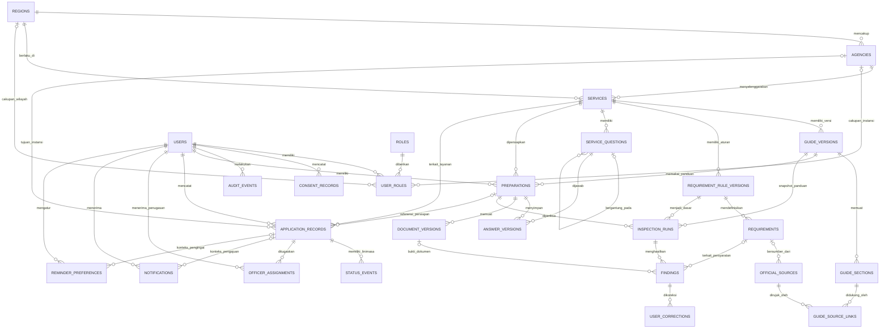
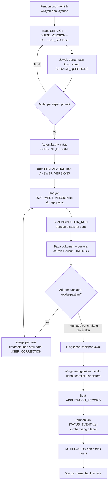

# ERD — JejakMasWowo

- **Versi:** 1.0
- **Status:** Baseline implementasi konseptual
- **Basis:** PRD JejakMasWowo v1.0, khususnya bagian hak akses, spesifikasi fitur, pemeriksaan AI, status dan siklus hidup, privasi, DFD, serta model data konseptual
- **Format diagram:** Mermaid ER diagram
- **Catatan:** ERD ini menerjemahkan model data konseptual dalam PRD menjadi rancangan relasional awal. Nama tabel, tipe data final, indeks, constraint, dan strategi penyimpanan masih perlu diselaraskan dengan `docs/database.md` dan skema ORM yang dipilih.

> ERD memisahkan **Zona Informasi Publik** (katalog layanan, panduan, aturan, sumber resmi) dari **Zona Data Privat Warga** (persiapan, dokumen, pemeriksaan AI, pengajuan, linimasa, notifikasi). Portal pemerintah berada di luar sistem pada baseline; tidak diasumsikan ada integrasi otomatis.

## 1. ERD konseptual



## 2. ERD fisik dengan atribut utama

Tipe data di bawah adalah tipe logis yang disarankan, bukan komitmen terhadap vendor database tertentu. `uuid`, `datetime`, `json`, dan `enum` dapat dipetakan ke tipe spesifik database yang digunakan.

```mermaid
erDiagram
    REGIONS {
        uuid id PK
        string code UK
        string name
        string region_type
        uuid parent_region_id FK
        boolean is_active
        datetime created_at
        datetime updated_at
    }
    AGENCIES {
        uuid id PK
        string name
        string agency_type
        uuid region_id FK
        string address
        string official_website
        string contact_info
        string cooperation_status
        boolean is_active
        datetime created_at
        datetime updated_at
    }
    SERVICES {
        uuid id PK
        string slug UK
        string name
        string category
        string summary
        uuid agency_id FK
        uuid region_id FK
        string publication_status
        datetime published_at
        datetime created_at
        datetime updated_at
    }
    GUIDE_VERSIONS {
        uuid id PK
        uuid service_id FK
        int version_number
        string status
        json procedure_json
        json official_cost_json
        json official_duration_json
        json application_channels_json
        datetime source_reviewed_at
        datetime published_at
        uuid created_by FK
    }
    GUIDE_SECTIONS {
        uuid id PK
        uuid guide_version_id FK
        string section_type
        string title
        json content_json
        int display_order
    }
    OFFICIAL_SOURCES {
        uuid id PK
        string url
        string title
        string publisher
        string source_type
        date source_published_date
        datetime accessed_at
        datetime last_checked_at
        string review_status
        datetime created_at
    }
    GUIDE_SOURCE_LINKS {
        uuid id PK
        uuid guide_section_id FK
        uuid source_id FK
        string claim_or_field
        string notes
    }
    REQUIREMENT_RULE_VERSIONS {
        uuid id PK
        uuid service_id FK
        int version_number
        string status
        json rules_config_json
        datetime effective_at
        datetime published_at
        uuid created_by FK
    }
    REQUIREMENTS {
        uuid id PK
        uuid rule_version_id FK
        string requirement_code
        string title
        string description
        string requirement_type
        boolean is_mandatory
        json condition_json
        uuid source_id FK
        int display_order
    }
    SERVICE_QUESTIONS {
        uuid id PK
        uuid service_id FK
        string question_key
        string label
        string input_type
        boolean is_public_nonpersonal
        boolean is_required
        json options_json
        json validation_json
        uuid depends_on_question_id FK
        json dependency_rule_json
        int display_order
        boolean is_active
    }
    USERS {
        uuid id PK
        string display_name
        string email UK
        string phone
        string auth_provider
        string password_hash
        string account_status
        datetime email_verified_at
        datetime last_login_at
        datetime created_at
        datetime updated_at
        datetime deleted_at
    }
    ROLES {
        uuid id PK
        string role_code UK
        string role_name
        string description
    }
    USER_ROLES {
        uuid id PK
        uuid user_id FK
        uuid role_id FK
        uuid agency_id FK
        uuid region_id FK
        uuid assigned_by FK
        datetime valid_from
        datetime valid_until
        boolean is_active
    }
    CONSENT_RECORDS {
        uuid id PK
        uuid user_id FK
        string purpose_code
        string notice_version
        boolean is_accepted
        datetime consented_at
        datetime withdrawn_at
        json metadata_json
    }
    PREPARATIONS {
        uuid id PK
        uuid user_id FK
        uuid service_id FK
        uuid guide_version_id FK
        string internal_reference UK
        string status
        int current_data_version
        int version
        datetime created_at
        datetime updated_at
        datetime archived_at
        datetime deleted_at
    }
    ANSWER_VERSIONS {
        uuid id PK
        uuid preparation_id FK
        uuid question_id FK
        int data_version
        json answer_json
        string value_origin
        datetime created_at
        uuid created_by FK
    }
    DOCUMENT_VERSIONS {
        uuid id PK
        uuid preparation_id FK
        uuid user_id FK
        string document_type
        int version_number
        string storage_key
        string original_filename
        string detected_mime_type
        bigint file_size_bytes
        string checksum_sha256
        string processing_status
        datetime uploaded_at
        datetime deleted_at
    }
    INSPECTION_RUNS {
        uuid id PK
        uuid preparation_id FK
        uuid user_id FK
        uuid guide_version_id FK
        uuid rule_version_id FK
        int data_version
        string status
        string engine_version
        string model_version
        json input_snapshot_json
        json summary_json
        string failure_code
        datetime queued_at
        datetime started_at
        datetime completed_at
    }
    FINDINGS {
        uuid id PK
        uuid inspection_run_id FK
        uuid requirement_id FK
        uuid document_version_id FK
        string finding_code
        string severity
        string category
        string title
        string explanation
        json evidence_json
        json suggested_actions_json
        float reading_confidence
        string resolution_status
        datetime created_at
        datetime updated_at
    }
    USER_CORRECTIONS {
        uuid id PK
        uuid finding_id FK
        uuid user_id FK
        json original_value_json
        json corrected_value_json
        string correction_note
        datetime created_at
    }
    APPLICATION_RECORDS {
        uuid id PK
        uuid user_id FK
        uuid service_id FK
        uuid preparation_id FK
        uuid agency_id FK
        string internal_reference UK
        string official_reference
        date submitted_date
        string submission_channel
        string source_mode
        string status_summary
        string citizen_notes
        int version
        datetime created_at
        datetime updated_at
        datetime archived_at
    }
    STATUS_EVENTS {
        uuid id PK
        uuid application_id FK
        uuid actor_user_id FK
        string status_code
        string source_type
        string source_label
        string description
        string revision_reason
        string next_action
        datetime occurred_at
        datetime recorded_at
        json metadata_json
    }
    OFFICER_ASSIGNMENTS {
        uuid id PK
        uuid application_id FK
        uuid officer_user_id FK
        uuid assigned_by FK
        string assignment_status
        datetime assigned_at
        datetime ended_at
    }
    NOTIFICATIONS {
        uuid id PK
        uuid user_id FK
        uuid application_id FK
        string notification_type
        string title
        string body
        string target_path
        datetime created_at
        datetime read_at
        datetime delivered_at
    }
    REMINDER_PREFERENCES {
        uuid id PK
        uuid user_id FK
        uuid application_id FK
        string reminder_type
        string channel
        boolean is_enabled
        json schedule_config_json
        datetime created_at
        datetime updated_at
    }
    AUDIT_EVENTS {
        uuid id PK
        uuid actor_user_id FK
        string actor_role
        string action
        string object_type
        string object_id
        string request_id
        string outcome
        json metadata_json
        datetime created_at
    }

    REGIONS ||--o{ REGIONS : parent_of
    REGIONS ||--o{ AGENCIES : contains
    REGIONS ||--o{ SERVICES : scopes
    AGENCIES ||--o{ SERVICES : provides
    SERVICES ||--o{ GUIDE_VERSIONS : versions
    GUIDE_VERSIONS ||--o{ GUIDE_SECTIONS : contains
    GUIDE_SECTIONS ||--o{ GUIDE_SOURCE_LINKS : references
    OFFICIAL_SOURCES ||--o{ GUIDE_SOURCE_LINKS : supports
    SERVICES ||--o{ REQUIREMENT_RULE_VERSIONS : rules
    REQUIREMENT_RULE_VERSIONS ||--o{ REQUIREMENTS : defines
    OFFICIAL_SOURCES o|--o{ REQUIREMENTS : grounds
    SERVICES ||--o{ SERVICE_QUESTIONS : asks
    SERVICE_QUESTIONS o|--o{ SERVICE_QUESTIONS : conditional_on
    USERS ||--o{ USER_ROLES : has
    ROLES ||--o{ USER_ROLES : assigned
    AGENCIES o|--o{ USER_ROLES : scope
    REGIONS o|--o{ USER_ROLES : scope
    USERS ||--o{ CONSENT_RECORDS : consents
    USERS ||--o{ PREPARATIONS : owns
    SERVICES ||--o{ PREPARATIONS : selected_for
    GUIDE_VERSIONS ||--o{ PREPARATIONS : based_on
    PREPARATIONS ||--o{ ANSWER_VERSIONS : answers
    SERVICE_QUESTIONS ||--o{ ANSWER_VERSIONS : answered
    PREPARATIONS ||--o{ DOCUMENT_VERSIONS : documents
    USERS ||--o{ DOCUMENT_VERSIONS : uploads
    PREPARATIONS ||--o{ INSPECTION_RUNS : inspected
    REQUIREMENT_RULE_VERSIONS ||--o{ INSPECTION_RUNS : applied
    GUIDE_VERSIONS ||--o{ INSPECTION_RUNS : snapshots
    INSPECTION_RUNS ||--o{ FINDINGS : emits
    DOCUMENT_VERSIONS o|--o{ FINDINGS : evidence
    REQUIREMENTS o|--o{ FINDINGS : checks
    FINDINGS ||--o{ USER_CORRECTIONS : corrected_by
    USERS ||--o{ USER_CORRECTIONS : submits
    USERS ||--o{ APPLICATION_RECORDS : records
    SERVICES ||--o{ APPLICATION_RECORDS : concerns
    PREPARATIONS o|--o{ APPLICATION_RECORDS : reference
    AGENCIES o|--o{ APPLICATION_RECORDS : target
    APPLICATION_RECORDS ||--o{ STATUS_EVENTS : timeline
    USERS o|--o{ STATUS_EVENTS : records
    USERS ||--o{ OFFICER_ASSIGNMENTS : officer
    APPLICATION_RECORDS ||--o{ OFFICER_ASSIGNMENTS : assigned
    USERS ||--o{ NOTIFICATIONS : receives
    APPLICATION_RECORDS o|--o{ NOTIFICATIONS : related
    USERS ||--o{ REMINDER_PREFERENCES : configures
    APPLICATION_RECORDS o|--o{ REMINDER_PREFERENCES : reminds
    USERS o|--o{ AUDIT_EVENTS : acts
```



## 3. Ringkasan zona data

### 3.1 Zona informasi publik

| Entitas | Fungsi | Catatan |
|---|---|---|
| `REGIONS` | Hirarki wilayah layanan | Struktur wilayah final mengikuti cakupan yang dipilih |
| `AGENCIES` | Instansi/kanal penyelenggara | Tidak berarti instansi telah bekerja sama dengan produk |
| `SERVICES` | Katalog layanan publik | Informasi publik dapat diakses tanpa login |
| `GUIDE_VERSIONS` | Versi panduan layanan | Versi lama dipertahankan untuk audit dan penelusuran |
| `GUIDE_SECTIONS` | Bagian prosedur, biaya, waktu, persyaratan, kanal | Konten dipisah agar sumber dapat dikaitkan per klaim |
| `OFFICIAL_SOURCES` | Referensi sumber resmi | Simpan URL, penerbit, waktu akses/peninjauan, dan status |
| `GUIDE_SOURCE_LINKS` | Penghubung bagian panduan dengan sumber | Mendukung penelusuran klaim ke sumber |
| `REQUIREMENT_RULE_VERSIONS` | Versi aturan pemeriksaan | Hasil lama harus tetap merujuk versi yang digunakan |
| `REQUIREMENTS` | Persyaratan per layanan dan kondisi | Persyaratan wajib harus memiliki dasar yang dapat ditelusuri |
| `SERVICE_QUESTIONS` | Pertanyaan kondisional | Pertanyaan publik nonidentitas dapat dijawab tanpa login |

### 3.2 Zona identitas dan akses

| Entitas | Fungsi | Catatan |
|---|---|---|
| `USERS` | Akun warga, petugas, dan admin | Metode autentikasi masih perlu diputuskan |
| `ROLES` | Definisi peran | Minimal warga, petugas, admin |
| `USER_ROLES` | Penugasan peran dengan cakupan | Akun publik tidak boleh memilih peran petugas/admin sendiri |
| `CONSENT_RECORDS` | Riwayat persetujuan penggunaan data | Catat tujuan dan versi pemberitahuan yang disetujui |
| `AUDIT_EVENTS` | Jejak aksi penting | Hindari isi dokumen atau identitas lengkap dalam metadata |

### 3.3 Zona data privat warga

| Entitas | Fungsi | Catatan |
|---|---|---|
| `PREPARATIONS` | Ruang persiapan pribadi | Nomor internal harus dibedakan dari nomor pengajuan resmi |
| `ANSWER_VERSIONS` | Jawaban formulir per versi data | Perubahan jawaban dapat membatalkan hasil pemeriksaan lama |
| `DOCUMENT_VERSIONS` | Metadata dan versi berkas privat | Berkas berada di penyimpanan privat; `storage_key` bukan URL publik |
| `INSPECTION_RUNS` | Satu proses pemeriksaan AI | Menyimpan snapshot input, versi aturan, status, dan versi engine/model bila tersedia |
| `FINDINGS` | Temuan pemeriksaan dan tindakan | Skor keyakinan pembacaan bukan skor keaslian dokumen |
| `USER_CORRECTIONS` | Koreksi warga terhadap pembacaan/temuan | Koreksi tidak dianggap sebagai verifikasi resmi |
| `APPLICATION_RECORDS` | Catatan pengajuan yang dibuat warga | Dapat dibuat tanpa persiapan AI; nomor resmi bersifat opsional |
| `STATUS_EVENTS` | Linimasa peristiwa pengajuan | Bedakan sumber petugas, integrasi, catatan warga, dan simulasi |
| `OFFICER_ASSIGNMENTS` | Cakupan akses petugas pada pengajuan | Petugas hanya dapat membuka pengajuan yang ditugaskan/diizinkan |
| `NOTIFICATIONS` | Notifikasi dalam aplikasi | Jangan memasukkan isi dokumen sensitif ke badan notifikasi |
| `REMINDER_PREFERENCES` | Preferensi pengingat | Pengingat bukan sumber kebenaran status pengajuan |

## 4. Aturan relasi dan integritas data

1. **Kepemilikan privat:** setiap `PREPARATIONS`, `DOCUMENT_VERSIONS`, `INSPECTION_RUNS`, `APPLICATION_RECORDS`, `NOTIFICATIONS`, `REMINDER_PREFERENCES`, dan `USER_CORRECTIONS` harus memiliki jalur kepemilikan ke `USERS`. Server wajib memeriksa kepemilikan pada setiap permintaan.
2. **Petugas berbasis penugasan:** akses petugas ke pengajuan diberikan melalui `OFFICER_ASSIGNMENTS` dan cakupan yang relevan; peran petugas saja tidak membuka semua data.
3. **Draf bukan pengajuan:** `PREPARATIONS.internal_reference` tidak boleh diperlakukan sebagai nomor pengajuan resmi. `APPLICATION_RECORDS.official_reference` opsional.
4. **Pengajuan tidak wajib berasal dari AI:** `APPLICATION_RECORDS.preparation_id` boleh `NULL`, karena warga bisa mencatat pengajuan tanpa menggunakan fitur persiapan/pemeriksaan.
5. **Sumber status eksplisit:** `STATUS_EVENTS.source_type` minimal membedakan `citizen_report`, `officer`, `integration`, dan `simulation`. Status simulasi tidak boleh ditampilkan sebagai status pemerintah nyata.
6. **Snapshot pemeriksaan:** `INSPECTION_RUNS` harus menyimpan identitas versi jawaban, dokumen, panduan, dan aturan yang digunakan. Jangan menimpa hasil pemeriksaan lama ketika ada pemeriksaan baru.
7. **Invalidasi hasil lama:** jika data atau dokumen terkait berubah, tandai hasil pemeriksaan lama sebagai tidak berlaku untuk versi terbaru; jangan menghapus jejak historis.
8. **Persyaratan berbasis sumber:** persyaratan yang digunakan untuk pemeriksaan harus mengacu pada versi aturan dan sumber yang dapat ditelusuri. AI tidak boleh membuat persyaratan wajib baru tanpa dasar.
9. **Biaya/waktu tidak diketahui:** nilai tidak diketahui disimpan sebagai `NULL` atau status eksplisit, bukan dipaksa menjadi nol atau estimasi tanpa label.
10. **Versi panduan:** perubahan panduan/aturan menghasilkan versi baru; versi yang sudah dipakai dalam pemeriksaan tetap tersedia untuk audit.
11. **Pencatatan koreksi:** koreksi pembacaan menyimpan nilai awal, nilai koreksi, pelaku, dan waktu; koreksi tidak dianggap bukti sah secara hukum.
12. **Privasi audit:** metadata audit tidak boleh memuat file mentah, token, kata sandi, atau identitas sensitif secara berlebihan.
13. **Penghapusan:** penghapusan dokumen/akun harus mengikuti kebijakan retensi yang ditetapkan. `deleted_at` merupakan pola soft-delete opsional dan tidak menggantikan penghapusan berkas fisik sesuai kebijakan.
14. **Konsistensi perubahan:** gunakan `version` atau mekanisme optimistic concurrency pada data yang dapat diedit untuk mencegah perubahan saling menimpa.

## 5. Indeks dan constraint yang disarankan

Ini adalah rekomendasi implementasi, bukan detail yang dinyatakan eksplisit oleh PRD.

- Unique: `REGIONS.code`, `SERVICES.slug`, `(service_id, version_number)` pada `GUIDE_VERSIONS` dan `REQUIREMENT_RULE_VERSIONS`, `(preparation_id, question_id, data_version)` sesuai strategi versi, `(preparation_id, document_type, version_number)`, serta `ROLES.role_code`.
- Index: `SERVICES(publication_status, region_id, category)`, `OFFICIAL_SOURCES(review_status, last_checked_at)`, `PREPARATIONS(user_id, status, updated_at)`, `DOCUMENT_VERSIONS(preparation_id, document_type)`, `INSPECTION_RUNS(preparation_id, status, created_at)`, `FINDINGS(inspection_run_id, resolution_status)`, `APPLICATION_RECORDS(user_id, updated_at)`, `STATUS_EVENTS(application_id, occurred_at)`, `OFFICER_ASSIGNMENTS(officer_user_id, assignment_status)`, `NOTIFICATIONS(user_id, read_at, created_at)`, dan `AUDIT_EVENTS(actor_user_id, created_at)`.
- Check constraints: nilai `file_size_bytes` positif; versi lebih besar dari nol; `occurred_at`/`recorded_at` valid; status dan sumber dibatasi enum yang disepakati.
- Foreign key: tetapkan kebijakan `RESTRICT`, `CASCADE`, atau `SET NULL` per relasi setelah aturan retensi dan penghapusan disepakati. Hindari cascade yang tanpa sengaja menghapus jejak audit atau riwayat pemeriksaan.

## 6. Enum/domain awal yang disarankan

Nilai di bawah adalah usulan domain agar kontrak BE/FE konsisten. Sesuaikan sebelum migrasi pertama.

```text
publication_status:
  draft | published | archived

guide_review_status:
  current | needs_review | unavailable | archived

preparation_status:
  draft | queued | inspecting | needs_completion | needs_confirmation |
  ready_initial_check | inspection_incomplete | recheck_required | archived

inspection_status:
  queued | running | completed | failed | cancelled

finding_severity:
  info | warning | blocking

finding_resolution_status:
  open | corrected | confirmed_by_user | needs_official_confirmation | dismissed

application_status:
  citizen_recorded | received | verification | needs_revision |
  processing | completed | result_received | cancelled | rejected

status_source_type:
  citizen_report | officer | integration | simulation

submission_channel:
  online_portal | in_person | email | other

user_role:
  citizen | officer | admin

account_status:
  pending_verification | active | suspended | deletion_requested | deleted
```

Status pengajuan di atas adalah domain awal. Status khusus seperti penolakan/pembatalan perlu dipetakan ke prosedur layanan yang benar sebelum dipakai di produksi.

## 7. Alur data utama



## 8. Batasan dan keputusan yang masih terbuka

Hal berikut tidak ditetapkan final oleh PRD dan harus diputuskan sebelum skema produksi dibekukan:

- Metode autentikasi dan penyimpanan identitas akun (email/kata sandi masih usulan).
- Wilayah, instansi, serta layanan yang benar-benar masuk cakupan awal.
- Apakah dokumen produksi berupa dokumen pribadi nyata atau hanya dokumen sintetis untuk demonstrasi.
- Provider OCR/LLM, lokasi pemrosesan, kebijakan retensi prompt/hasil, dan apakah pemrosesan dilakukan melalui pihak ketiga.
- Batas format, ukuran, jumlah halaman, dan masa simpan dokumen.
- Kebijakan retensi/penghapusan akun, dokumen, hasil AI, dan audit.
- Apakah akun petugas hanya digunakan dalam mode simulasi atau ada kerja sama resmi.
- Apakah kelak tersedia integrasi status pemerintah. Baseline saat ini tidak mengasumsikan integrasi otomatis.
- Tipe database, strategi versi, penomoran internal, dan strategi penyimpanan file.
- Domain status final per layanan serta aturan waktu resmi dan hari kerja.

## 9. Definition of Done ERD

- [ ] Seluruh entitas konseptual di bagian 15 PRD telah dipetakan ke tabel atau keputusan eksplisit untuk tidak membuat tabel terpisah.
- [ ] Semua data privat memiliki jalur kepemilikan dan pemeriksaan otorisasi di sisi server.
- [ ] Peran petugas dibatasi melalui penugasan/cakupan, bukan hanya flag peran.
- [ ] Banyak-ke-banyak sumber dengan bagian panduan direpresentasikan melalui tabel penghubung `GUIDE_SOURCE_LINKS`.
- [ ] Versi panduan, aturan, jawaban, dokumen, dan hasil pemeriksaan dapat ditelusuri.
- [ ] Pengajuan bisa dicatat tanpa menjalankan pemeriksaan AI terlebih dahulu.
- [ ] Sumber status membedakan laporan warga, petugas, integrasi, dan simulasi.
- [ ] Nomor persiapan internal dibedakan dari nomor pengajuan resmi.
- [ ] Dokumen disimpan privat dan tidak dapat diakses lewat URL publik tanpa otorisasi.
- [ ] Kebijakan penghapusan/retensi dan audit disepakati sebelum data pribadi sungguhan digunakan.
- [ ] Nama kolom, tipe data, indeks, foreign key, dan constraint diselaraskan dengan skema ORM/migrasi aktual.
- [ ] Setiap persyaratan wajib pada pemeriksaan dapat ditelusuri ke versi aturan dan sumber yang mendasarinya.

---

**Prinsip baseline:** JejakMasWowo membantu warga memahami, menyiapkan, memeriksa, dan mengikuti pengurusan. Data persiapan dan dokumen tetap privat; hasil AI bukan keputusan resmi; portal pemerintah tetap di luar sistem sampai ada integrasi yang disetujui.
