# Product Requirements Document — DaftarIn

| Atribut | Keterangan |
| --- | --- |
| Versi | 1.0 |
| Tanggal | 26 Oktober 2026 |
| Bahasa produk | Bahasa Indonesia |
| Bentuk produk | Website responsif |
| Status | Spesifikasi produk berdasarkan diskusi; keputusan operasional yang masih terbuka dicatat pada bagian 24 |
| Fokus utama | Public Service Tracking |
| Subtema pendukung | Open Government Data |
| Tagline usulan | Tahu syaratnya, jelas langkahnya, terpantau prosesnya. |

> Dokumen ini menjelaskan kebutuhan produk, bukan menyatakan bahwa DaftarIn sudah dibangun, terhubung ke sistem pemerintah, atau memperoleh akses data pemerintah. Diagram menggunakan Mermaid dan perlu penampil Markdown yang mendukung Mermaid untuk dirender. Diagram tetap dapat dibaca sebagai kode pada penampil lain.

## Daftar isi

1. [Ringkasan produk](#1-ringkasan-produk)
2. [Masalah, tujuan, dan manfaat](#2-masalah-tujuan-dan-manfaat)
3. [Pengguna dan peran](#3-pengguna-dan-peran)
4. [Ruang lingkup dan status keputusan](#4-ruang-lingkup-dan-status-keputusan)
5. [Prinsip produk dan aturan bisnis](#5-prinsip-produk-dan-aturan-bisnis)
6. [Arsitektur informasi dan halaman](#6-arsitektur-informasi-dan-halaman)
7. [Hak akses](#7-hak-akses)
8. [Spesifikasi fitur](#8-spesifikasi-fitur)
9. [Spesifikasi pemeriksaan AI](#9-spesifikasi-pemeriksaan-ai)
10. [Status dan siklus hidup](#10-status-dan-siklus-hidup)
11. [Alur website menyeluruh](#11-alur-website-menyeluruh)
12. [Flowchart website](#12-flowchart-website)
13. [User Flow Diagram — UFD](#13-user-flow-diagram--ufd)
14. [Data Flow Diagram — DFD](#14-data-flow-diagram--dfd)
15. [Model data konseptual](#15-model-data-konseptual)
16. [Kebutuhan nonfungsional](#16-kebutuhan-nonfungsional)
17. [Privasi dan pengelolaan dokumen](#17-privasi-dan-pengelolaan-dokumen)
18. [Keadaan khusus dan penanganan kegagalan](#18-keadaan-khusus-dan-penanganan-kegagalan)
19. [Kriteria penerimaan dan skenario pengujian](#19-kriteria-penerimaan-dan-skenario-pengujian)
20. [Pengukuran keberhasilan](#20-pengukuran-keberhasilan)
21. [Prioritas implementasi](#21-prioritas-implementasi)
22. [Rencana demonstrasi lomba](#22-rencana-demonstrasi-lomba)
23. [Ketergantungan dan risiko](#23-ketergantungan-dan-risiko)
24. [Keputusan yang masih diperlukan](#24-keputusan-yang-masih-diperlukan)
25. [Glosarium](#25-glosarium)

## 1. Ringkasan produk

DaftarIn adalah website pendamping pengurusan layanan pemerintah yang menggabungkan panduan layanan, persiapan berkas, pemeriksaan awal berbantuan AI, dan pencatatan serta pelacakan pengajuan sesuai sumber pembaruan yang tersedia.

Produk menggabungkan dua konsep:

- **UrusJelas:** membantu warga memahami layanan, instansi tujuan, persyaratan, prosedur, biaya resmi, standar waktu resmi, dan kanal pengajuan.
- **JejakUrus:** membantu warga mencatat pengajuan, mengetahui perkembangan dari sumber yang tersedia, memahami permintaan perbaikan, dan menentukan tindak lanjut.

Pengalaman utama berbentuk **halaman interaktif**: pencarian, pilihan layanan, formulir bertahap, unggahan dokumen, hasil pemeriksaan, dan linimasa pengajuan. Chatbot merupakan fitur pendamping untuk menjelaskan hal yang membingungkan. Penggunaan chatbot tidak menjadi syarat untuk menyelesaikan proses utama.

Pemeriksaan AI bekerja terhadap dokumen yang diunggah, bukan sekadar checklist yang ditandai warga. Pemeriksaan menggabungkan pembacaan dokumen, aturan persyaratan layanan, pencocokan data, dan LLM untuk membantu interpretasi serta penjelasan hasil. AI membantu menemukan masalah awal; keputusan penerimaan dan pemeriksaan resmi tetap menjadi kewenangan instansi.

Alur inti:

**Landing page → cari layanan → pahami persyaratan → login saat mulai persiapan pribadi → isi data → unggah dokumen → pemeriksaan AI → perbaikan → ringkasan → kanal pengajuan resmi → catat pengajuan → pantau sesuai sumber pembaruan → selesai.**

## 2. Masalah, tujuan, dan manfaat

### 2.1 Masalah pengguna

| Masalah | Dampak | Respons produk |
| --- | --- | --- |
| Warga tidak mengetahui nama layanan | Sulit mencari prosedur yang tepat | Pencarian berdasarkan kebutuhan sehari-hari |
| Persyaratan berbeda menurut wilayah atau kondisi | Dokumen yang disiapkan tidak sesuai | Panduan wilayah dan pertanyaan kondisional |
| Informasi tersebar dan tidak jelas kebaruannya | Warga mengikuti panduan yang tidak relevan | Sumber resmi, tanggal peninjauan, dan versi panduan |
| Kekurangan dokumen baru diketahui setelah mengajukan | Pengulangan proses dan revisi | Pemeriksaan awal dokumen dengan AI |
| Hasil pemeriksaan sulit dipahami | Warga tidak tahu cara memperbaiki | Temuan spesifik dengan lokasi masalah dan tindakan |
| Warga tidak mengetahui perkembangan pengajuan | Ketidakpastian dan pencarian informasi berulang | Linimasa dengan sumber serta waktu pembaruan |
| Pengajuan tertunda atau dikembalikan | Warga tidak tahu langkah selanjutnya | Arahan perbaikan dan kanal tindak lanjut |

### 2.2 Tujuan produk

1. Membantu warga menemukan panduan layanan yang sesuai wilayah dan kondisi.
2. Mengurangi kekurangan berkas yang dapat dideteksi sebelum pengajuan resmi.
3. Mengubah hasil pemeriksaan menjadi tindakan perbaikan yang jelas.
4. Memisahkan persiapan pribadi dari pengajuan resmi agar warga tidak salah memahami tahap proses.
5. Menampilkan perkembangan pengajuan secara jujur menurut sumber yang benar-benar tersedia.
6. Mempermudah pengelolaan informasi layanan dan pembaruan status oleh peran yang berwenang.

### 2.3 Manfaat yang diharapkan

- **Warga:** lebih siap, memahami prosedur, dan mengetahui tindakan berikutnya.
- **Petugas:** menerima berkas yang lebih siap jika temuan awal berhasil diperbaiki; manfaat ini perlu dibuktikan melalui evaluasi.
- **Pengelola:** memiliki panduan dan aturan yang terpusat, dapat diperbarui, serta dapat ditelusuri versinya.

### 2.4 Hal yang bukan tujuan

- Menggantikan keputusan instansi atau menyatakan dokumen sah secara hukum.
- Menjamin permohonan pasti diterima atau selesai pada tanggal tertentu.
- Mengakses sistem pemerintah tanpa integrasi dan otorisasi resmi.
- Menjadi layanan pengaduan publik nasional atau sistem keputusan kebijakan pada versi awal.
- Memaksakan semua subtema lomba ke dalam satu produk.

## 3. Pengguna dan peran

| Peran | Kebutuhan | Batas kewenangan |
| --- | --- | --- |
| Pengunjung | Memahami produk, mencari layanan, membaca panduan, bertanya umum | Tidak mengakses dokumen atau pengajuan pribadi |
| Warga terdaftar | Menyiapkan berkas, menjalankan pemeriksaan AI, menyimpan dan memantau proses sendiri | Hanya sumber daya milik akun sendiri |
| Petugas | Memperbarui pengajuan yang ditugaskan, menjelaskan revisi dan penyelesaian | Tidak melihat seluruh draf pribadi warga |
| Admin | Mengelola informasi, aturan pemeriksaan, akun petugas, dan konfigurasi | Tidak otomatis memperoleh akses isi dokumen pribadi |

### 3.1 Skenario penggunaan utama

- Warga baru mencari layanan melalui landing page tanpa akun.
- Warga yang belum memahami persyaratan menjawab pertanyaan interaktif.
- Warga mengunggah dokumen dan mendapatkan temuan perbedaan data atau bagian yang tidak terbaca.
- Warga memperbaiki temuan tanpa harus memakai chatbot.
- Warga mencatat pengajuan yang telah dilakukan di kanal resmi.
- Petugas simulasi memperbarui status dalam demonstrasi lomba.
- Admin memperbarui panduan dan menerbitkan versi aturan baru.

## 4. Ruang lingkup dan status keputusan

### 4.1 Arah produk yang telah disepakati

- Nama produk: **DaftarIn**.
- Website menggunakan halaman interaktif sebagai pengalaman utama.
- Chatbot berfungsi sebagai bantuan opsional untuk warga yang kebingungan.
- Pemeriksaan awal menggunakan AI/LLM untuk membaca dan memeriksa dokumen, bukan checklist mandiri.
- Terdapat landing page dan akses panduan publik tanpa login.
- Login diperlukan untuk ruang persiapan, dokumen, hasil pemeriksaan, dan riwayat pribadi.
- Panduan layanan dan pendampingan proses terhubung dalam satu perjalanan pengguna.

### 4.2 Baseline spesifikasi dalam PRD

Detail berikut merupakan rancangan konkret agar produk dapat diimplementasikan dan ditinjau. Detail operasionalnya dapat disesuaikan sebelum pembangunan:

- Dashboard warga, daftar persiapan, daftar pengajuan, dan notifikasi dalam aplikasi.
- Pemisahan status persiapan dari status pengajuan.
- Pemisahan peran warga, petugas, dan admin.
- Pemeriksaan yang menyimpan versi dokumen dan aturan agar temuan dapat ditelusuri.
- Akun petugas dan data berlabel simulasi untuk demonstrasi jika tidak ada kerja sama resmi.
- Pengajuan dilakukan melalui kanal resmi selama belum ada integrasi yang disetujui.

### 4.3 Usulan yang belum menjadi keputusan

| Pokok | Status |
| --- | --- |
| Satu kabupaten/kota | Usulan pembatasan cakupan |
| Instansi Disdukcapil | Usulan awal |
| KK, akta kelahiran, dan perpindahan penduduk | Contoh tiga layanan; belum dipilih |
| Tagline | Usulan |
| Email dan kata sandi | Usulan metode autentikasi |
| Dokumen contoh atau dokumen pribadi sungguhan | Belum ditetapkan |
| Kerja sama petugas dan integrasi resmi | Belum tersedia/belum dikonfirmasi |
| Teknologi, penyedia OCR/LLM, hosting, dan anggaran | Belum ditetapkan |

## 5. Prinsip produk dan aturan bisnis

| ID | Aturan |
| --- | --- |
| BR-01 | Panduan umum dapat dibaca tanpa login. |
| BR-02 | Data pribadi, dokumen, hasil AI, dan pengajuan pribadi memerlukan autentikasi dan pemeriksaan kepemilikan. |
| BR-03 | Seluruh perjalanan utama dapat diselesaikan tanpa chatbot. |
| BR-04 | Pemeriksaan awal menggunakan sumber persyaratan yang dapat ditelusuri; AI tidak boleh membuat persyaratan wajib baru tanpa dasar. |
| BR-05 | Hasil pemeriksaan bukan persetujuan resmi atau bukti keaslian dokumen. |
| BR-06 | Ketidakpastian pembacaan ditampilkan; skor kepercayaan bukan ukuran keaslian. |
| BR-07 | Mengunggah dokumen ke DaftarIn tidak berarti mengajukan ke pemerintah. |
| BR-08 | Nomor persiapan internal harus berbeda label dari nomor pengajuan resmi. |
| BR-09 | Status instansi, catatan warga, dan simulasi memiliki label sumber berbeda. |
| BR-10 | AI tidak menghasilkan perubahan status pengajuan berdasarkan perkiraan. |
| BR-11 | Standar waktu resmi, waktu berjalan, dan estimasi ditampilkan terpisah. |
| BR-12 | Perubahan dokumen atau data terkait membatalkan keberlakuan hasil pemeriksaan sebelumnya untuk versi terbaru. |
| BR-13 | Draf persiapan pribadi tidak otomatis dapat dibaca petugas. |
| BR-14 | Akun publik tidak dapat mendaftarkan dirinya sebagai petugas atau admin. |
| BR-15 | Informasi atau data simulasi tidak boleh ditampilkan sebagai data pemerintah nyata. |
| BR-16 | Perubahan panduan/aturan diterbitkan sebagai versi; hasil lama tetap memiliki rujukan versi awalnya. |

## 6. Arsitektur informasi dan halaman

### 6.1 Halaman publik

| Halaman | Isi utama | Tindakan utama |
| --- | --- | --- |
| Landing page | Manfaat, pencarian, layanan populer, cara kerja, batas AI/pelacakan, FAQ | Cari layanan |
| Katalog layanan | Pencarian, filter wilayah/kategori, hasil dan keadaan kosong | Pilih layanan |
| Detail layanan | Instansi, persyaratan, biaya, prosedur, standar waktu, kanal, sumber | Mulai persiapan |
| Pertanyaan kebutuhan | Pertanyaan kondisional tanpa identitas pribadi | Lihat kebutuhan berkas |
| Contoh pemeriksaan | Dokumen sintetis dan hasil demonstrasi | Coba contoh |
| Masuk/daftar/pemulihan akun | Akses akun dan verifikasi sesuai metode terpilih | Masuk atau daftar |
| Tentang/cara kerja/privasi | Penjelasan pengelola, penggunaan data, bantuan | Baca atau hubungi kanal bantuan |

### 6.2 Halaman warga setelah login

| Halaman | Isi utama | Tindakan utama |
| --- | --- | --- |
| Dashboard | Draf, temuan terbuka, pengajuan berjalan, notifikasi | Lanjutkan tindakan terakhir |
| Persiapan saya | Daftar draf dan hasil pemeriksaan | Buka atau buat persiapan |
| Formulir persiapan | Pertanyaan dan data sesuai layanan | Simpan dan lanjut |
| Dokumen | Kartu unggahan, pratinjau, versi, hapus/ganti | Periksa berkas |
| Progres pemeriksaan | Tahap proses dan kegagalan jika ada | Tunggu atau coba ulang |
| Hasil pemeriksaan | Ringkasan, temuan, dasar persyaratan, tindakan | Perbaiki |
| Ringkasan kesiapan | Data, dokumen, hasil terakhir, batas pemeriksaan | Buka kanal resmi |
| Catat pengajuan | Nomor resmi opsional jika belum diberikan, tanggal, kanal | Simpan pengajuan |
| Pengajuan saya | Daftar pengajuan dan sumber pembaruan | Lihat detail |
| Detail pengajuan | Linimasa, revisi, waktu, sumber, tindak lanjut | Lakukan tindakan berikutnya |
| Notifikasi | Pengingat dan pembaruan yang benar-benar tercatat | Buka konteks terkait |
| Profil dan privasi | Akun, preferensi, penghapusan dokumen/akun | Kelola data |

### 6.3 Halaman petugas dan admin

- **Petugas:** daftar penugasan, detail pengajuan yang diizinkan, pembaruan status, permintaan revisi, informasi penyelesaian.
- **Admin:** katalog wilayah/instansi/layanan, sumber, editor panduan, versi aturan, pengelolaan petugas, dan audit perubahan.
- Navigasi disesuaikan dengan peran; menyembunyikan menu harus disertai pembatasan akses di sisi server.

### 6.4 Susunan landing page

1. Header: logo, Cari Layanan, Cara Kerja, Masuk, Daftar.
2. Hero: manfaat utama dan tombol Cari Layanan.
3. Pemilih wilayah dan kolom pencarian yang dapat langsung digunakan.
4. Layanan tersedia/populer sesuai cakupan nyata.
5. Penjelasan empat tahap: pahami, siapkan dan periksa, ajukan, pantau.
6. Penjelasan pemeriksaan AI dan batasnya.
7. Penjelasan sumber pelacakan; label simulasi jika relevan.
8. FAQ dan bantuan.
9. Footer: tentang pengelola, privasi, sumber, kontak.

## 7. Hak akses

Legenda: **Ya** = tersedia; **Sendiri** = hanya data milik akun; **Ditugaskan** = hanya sesuai kewenangan; **Terbatas** = sesuai izin eksplisit; **Tidak** = tidak tersedia.

| Kemampuan | Pengunjung | Warga | Petugas | Admin |
| --- | --- | --- | --- | --- |
| Membaca panduan dan sumber | Ya | Ya | Ya | Ya |
| Pertanyaan kebutuhan tanpa data pribadi | Ya | Ya | Ya | Ya |
| Chatbot panduan umum | Ya | Ya | Ya | Ya |
| Mencoba dokumen contoh | Ya | Ya | Ya | Ya |
| Menyimpan persiapan pribadi | Tidak | Sendiri | Tidak melalui peran petugas | Tidak melalui peran admin |
| Unggah dan periksa dokumen pribadi | Tidak | Sendiri | Tidak melalui peran petugas | Tidak melalui peran admin |
| Melihat hasil AI pribadi | Tidak | Sendiri | Terbatas, jika dibagikan dalam alur resmi yang diizinkan | Tidak secara bawaan |
| Melihat catatan pengajuan pribadi | Tidak | Sendiri | Ditugaskan | Metadata operasional sesuai izin |
| Memperbarui status petugas | Tidak | Tidak | Ditugaskan | Tidak melalui peran admin |
| Menambah catatan warga | Tidak | Sendiri | Tidak | Tidak |
| Mengelola panduan dan aturan | Tidak | Tidak | Tidak | Ya |
| Mengelola akun petugas | Tidak | Tidak | Tidak | Ya |
| Membaca audit administratif | Tidak | Tidak | Terbatas | Terbatas |

Jika satu orang menjalankan lebih dari satu peran, hak tersebut harus diberikan secara eksplisit. Hak admin tidak boleh menjadi pintasan untuk membaca semua dokumen warga.

## 8. Spesifikasi fitur

### F-01 — Pencarian dan katalog layanan

**Tujuan:** menemukan layanan melalui istilah resmi atau kebutuhan sehari-hari.

**Kebutuhan:**

- Memilih wilayah dan menyimpan pilihan pada sesi penelusuran.
- Mencari dengan kata kunci, sinonim, dan kategori yang dikelola.
- Menampilkan nama layanan, instansi, wilayah, ringkasan, dan keadaan sumber.
- Tidak menawarkan layanan wilayah lain seolah berlaku di wilayah pilihan.
- Jika hasil kosong, menawarkan perbaikan kata kunci atau perubahan wilayah.
- Pencarian dasar tidak bergantung pada chatbot atau keberhasilan LLM.

**Keluaran:** daftar layanan relevan dan tautan detail.

### F-02 — Panduan layanan dengan sumber

**Tujuan:** menyediakan informasi pengurusan yang dapat diperiksa asalnya.

**Kebutuhan:**

- Menampilkan persyaratan, prosedur, biaya resmi, standar waktu, instansi, dan kanal.
- Menyimpan sumber untuk setiap kelompok informasi penting, bukan hanya tautan umum di footer.
- Membedakan tanggal sumber, tanggal peninjauan pengelola, dan tanggal penerbitan versi panduan jika tersedia.
- Jika biaya atau waktu tidak diketahui, menulis “Belum tersedia pada sumber yang dicatat”, bukan mengasumsikan gratis atau memberi waktu buatan.
- Menjelaskan dasar penghitungan waktu jika diketahui, seperti hari kerja dan titik awal layanan.
- Menampilkan peringatan informasi perlu ditinjau jika sumber berubah atau tidak dapat diakses.

### F-03 — Pertanyaan kebutuhan dan formulir kondisional

**Tujuan:** menentukan isian serta dokumen yang relevan dengan kondisi pemohon.

**Kebutuhan:**

- Pertanyaan publik hanya memuat kondisi nonidentitas yang diperlukan untuk menentukan kebutuhan.
- Pengisian identitas dan penyimpanan pribadi dimulai setelah login.
- Pertanyaan memiliki penjelasan, pilihan, validasi, dan dependensi yang jelas.
- Perubahan jawaban menampilkan perubahan kebutuhan berkas sebelum warga melanjutkan.
- Dokumen yang tidak lagi relevan tidak dihapus diam-diam; warga diberi pilihan pengelolaan.
- Warga dapat mundur, menyimpan draf, dan melanjutkan.

### F-04 — Autentikasi dan kelanjutan proses

**Tujuan:** melindungi ruang pribadi tanpa menghalangi akses informasi.

**Kebutuhan:**

- Menyediakan masuk, daftar, keluar, pemulihan akses, dan verifikasi sesuai metode yang dipilih.
- Usulan awal menggunakan email/kata sandi; keputusan teknis belum final.
- Tidak meminta NIK atau foto KTP hanya untuk membuat akun.
- Login diminta sebelum mengisi/menyimpan identitas, mengunggah dokumen, atau membuka riwayat pribadi.
- Menyimpan konteks layanan, wilayah, dan jawaban nonpribadi selama perpindahan login.
- Setelah berhasil masuk, kembali ke tujuan awal; jika tidak ada tujuan, buka dashboard.
- Jika sesi berakhir, hentikan akses pribadi dan minta masuk kembali tanpa mengekspos data pada URL.
- Tautan publik dan kanal pemerintah tetap dapat dibuka tanpa akun.

### F-05 — Dashboard dan penyimpanan persiapan

**Tujuan:** memperlihatkan tindakan berikutnya secara jelas.

**Kebutuhan:**

- Menampilkan draf, persiapan yang perlu revisi, ringkasan kesiapan, dan pengajuan yang dicatat.
- Memisahkan persiapan dengan pengajuan resmi.
- Setiap kartu memiliki layanan, wilayah, waktu perubahan, status, dan satu tindakan utama.
- Menyimpan setelah langkah berhasil; jika penyimpanan gagal, tampilkan bahwa perubahan belum tersimpan.
- Akun baru memiliki keadaan kosong dan tombol Cari Layanan.

### F-06 — Unggah dan pengelolaan dokumen

**Tujuan:** menyediakan bahan pemeriksaan AI secara aman dan mudah dipahami.

**Kebutuhan:**

- Kartu unggahan sesuai jenis dokumen yang dibutuhkan.
- Usulan format awal PDF, JPG, dan PNG; format, ukuran, dan jumlah halaman final ditetapkan sebelum pembangunan.
- Batas unggah ditampilkan sebelum pengguna memilih file dan divalidasi kembali di server.
- Mendukung pratinjau, ganti, hapus, dan informasi unggahan berhasil/gagal.
- Memeriksa tipe file aktual, bukan hanya ekstensi.
- Menolak file rusak, format tidak didukung, atau file terkunci yang tidak dapat diproses dengan pesan yang dapat ditindaklanjuti.
- Tidak meminta kata sandi dokumen melalui chatbot; pengguna dapat mengunggah salinan yang dapat diproses jika sesuai haknya.
- Penggantian file membuat versi baru dan menandai hasil sebelumnya tidak berlaku bagi versi terbaru.
- Dokumen pribadi tidak disimpan pada URL publik yang dapat diakses tanpa otorisasi.

### F-07 — Pemeriksaan awal AI

**Tujuan:** menemukan masalah yang dapat dideteksi sebelum pengajuan resmi.

**Masukan:** data formulir, dokumen versi aktif, jawaban kondisi, versi persyaratan dan aturan.

**Keluaran:** ringkasan hasil, temuan, bukti lokasi, tingkat kepastian pembacaan, dan tindakan perbaikan.

**Kebutuhan:**

- Menjalankan pemeriksaan melalui tombol, tanpa percakapan wajib.
- Membaca dokumen dan memeriksa kelengkapan, jenis, keterbacaan, informasi wajib, serta kecocokan data yang relevan.
- Menampilkan progres proses dan hasil parsial hanya jika jelas bagian mana yang belum selesai.
- Menyimpan referensi versi input dan aturan pada setiap proses.
- Memisahkan kekurangan terdeteksi, ketidakpastian AI, dan kesalahan teknis.
- Tidak menampilkan “siap” jika pemeriksaan wajib belum selesai atau gagal.
- Tidak mengklaim memverifikasi keaslian, validitas hukum, atau data ke basis data pemerintah.

### F-08 — Hasil, revisi, dan pemeriksaan ulang

**Tujuan:** membuat setiap temuan dapat ditindaklanjuti.

**Kebutuhan:**

- Ringkasan hasil: perlu dilengkapi, perlu diperiksa ulang, atau siap berdasarkan pemeriksaan awal.
- Temuan berisi judul, penjelasan, dokumen/kolom terkait, lokasi jika tersedia, sumber persyaratan, dan tindakan.
- Tindakan dapat berupa ubah formulir, ganti dokumen, tambah dokumen, atau koreksi pembacaan.
- Koreksi warga disimpan dengan asal “dikonfirmasi pengguna”, bukan mengganti hasil OCR tanpa jejak.
- Pemeriksaan ulang menggunakan versi terbaru dan menunjukkan temuan yang terselesaikan/masih terbuka.
- Perubahan nama file saja tidak dianggap menyelesaikan masalah isi.
- Jika ada perbedaan data yang tidak dapat diselesaikan otomatis, arahkan untuk konfirmasi ke instansi.

### F-09 — Ringkasan dan pengalihan ke kanal resmi

**Tujuan:** menghubungkan persiapan dengan langkah pengajuan yang benar.

**Kebutuhan:**

- Menampilkan layanan, wilayah, data, berkas, hasil terakhir, dan catatan yang tersisa.
- Tindakan utama membuka kanal resmi atau petunjuk pelayanan langsung.
- Menjelaskan bahwa proses persiapan belum dikirim ke pemerintah.
- Tidak mengirim dokumen ke situs tujuan secara otomatis tanpa integrasi, persetujuan, dan mekanisme yang ditetapkan.
- Warga tetap dapat membaca/membuka kanal resmi meskipun belum menjalankan AI; AI bukan prasyarat hukum untuk mengurus layanan.
- Jika persiapan belum selesai, status kekurangannya tetap terlihat dan tidak diberi label siap.

### F-10 — Pencatatan dan pelacakan pengajuan

**Tujuan:** menyimpan konteks pengajuan dan menampilkan pembaruan yang dapat dipercaya asalnya.

**Kebutuhan:**

- Mencatat tanggal, kanal, layanan, nomor resmi jika tersedia, dan sumber pencatatan.
- Nomor persiapan dan nomor resmi dipisahkan.
- Nomor resmi yang diketik warga diberi label “dicatat warga”; bukan bukti nomor telah diverifikasi.
- Menampilkan linimasa dari peristiwa, bukan hanya satu status yang terus ditimpa.
- Setiap peristiwa memiliki sumber, waktu kejadian jika diketahui, waktu dicatat, dan penulis/pengimpor.
- Catatan warga tidak boleh ditampilkan sebagai pembaruan petugas.
- Jika hanya ada catatan warga, judul/status menjelaskan bahwa belum ada pembaruan dari instansi.
- Akses ditentukan oleh akun dan kewenangan, bukan nomor pengajuan semata.
- Detail status dari sistem lain hanya tersedia jika ada kanal atau integrasi yang benar-benar mendukungnya.

### F-11 — Revisi resmi, waktu, dan tindak lanjut

**Tujuan:** membantu warga bertindak saat pengajuan perlu diperbaiki atau belum selesai.

**Kebutuhan:**

- Permintaan revisi menampilkan alasan dan tindakan, serta sumber yang mengeluarkannya.
- Warga dapat menautkan revisi ke versi persiapan baru tanpa menghapus riwayat lama.
- Pengiriman revisi mengikuti kanal yang berlaku, tidak otomatis terjadi setelah periksa ulang AI.
- Standar waktu resmi ditampilkan bersama dasar penghitungannya jika tersedia.
- Penghitungan tenggat otomatis tidak diaktifkan jika aturan hari kerja, titik awal, atau jeda proses belum diketahui.
- Tautan bantuan/pengaduan mengikuti layanan dan wilayah yang tercatat.
- Sistem membantu membuka kanal pengaduan; tidak mengirim pengaduan atas nama warga secara otomatis.

### F-12 — Notifikasi dan pengingat

**Tujuan:** mengingatkan tindakan yang relevan tanpa menciptakan status palsu.

**Baseline:** notifikasi dalam aplikasi. Email, push, atau kanal lain menjadi perluasan setelah dipilih.

**Pemicu:** pemeriksaan selesai, pemeriksaan gagal, revisi tercatat, status berubah dari sumber tersedia, pengingat pilihan warga.

**Kebutuhan:**

- Menautkan notifikasi ke objek terkait dan menyediakan status dibaca.
- Membedakan “pengingat untuk memeriksa perkembangan” dari “ada perkembangan baru”.
- Tidak memasukkan isi dokumen, nomor identitas lengkap, atau rincian sensitif dalam pratinjau notifikasi.
- Mencegah pengiriman duplikat untuk peristiwa yang sama.

### F-13 — Chatbot pendamping

**Tujuan:** membantu warga yang kebingungan pada halaman yang sedang digunakan.

**Kebutuhan:**

- Tombol bantuan opsional, tidak terbuka paksa atau mengambil alih layar utama.
- Pengunjung memperoleh jawaban umum dari panduan yang tersedia.
- Warga login dapat meminta penjelasan temuan pada persiapan miliknya sesuai izin akses.
- Konteks dokumen pribadi tidak disertakan secara otomatis ke semua percakapan.
- Chatbot memberi sumber untuk penjelasan persyaratan dan menyatakan jika informasi tidak tersedia.
- Chatbot tidak mengubah data, mengirim berkas, menutup temuan, atau memperbarui status hanya karena diminta melalui chat.
- Untuk tindakan, chatbot menyediakan tautan ke halaman/formulir yang sesuai.
- Jika layanan chatbot gagal, seluruh alur utama tetap berfungsi.

### F-14 — Ruang kerja petugas

**Tujuan:** menyediakan sumber pembaruan manual jika petugas memang dilibatkan.

**Kebutuhan:**

- Login dan daftar pengajuan sesuai penugasan.
- Detail pengajuan hanya memuat data yang boleh dibagikan dalam alur tersebut.
- Pembaruan status mengikuti transisi yang diizinkan dan menyimpan catatan audit.
- Permintaan revisi memerlukan alasan serta langkah perbaikan.
- Penyelesaian memuat informasi pengambilan/akses hasil jika tersedia.
- Pengaitan catatan warga dengan pengajuan yang dikelola petugas memerlukan verifikasi/persetujuan sesuai proses operasional; tidak otomatis dari nomor yang diketik warga.
- Mode demonstrasi memberi label simulasi pada akun, pengajuan, dan linimasa.
- Keberadaan modul petugas bukan bukti kerja sama dengan instansi.

### F-15 — Pengelolaan panduan, aturan, dan akun petugas

**Tujuan:** menjaga panduan serta dasar pemeriksaan tetap konsisten.

**Kebutuhan:**

- Admin mengelola wilayah, instansi, layanan, sumber, persyaratan, pertanyaan, aturan, dan kanal.
- Perubahan melalui draf, pratinjau, lalu publikasi versi baru.
- Publikasi memerlukan sumber dan tanggal peninjauan untuk informasi penting.
- Aturan pemeriksaan diuji terhadap dokumen sintetis sebelum diterbitkan.
- Hasil pemeriksaan lama menyimpan rujukan versi; tidak diam-diam dinilai dengan aturan baru.
- Jika persyaratan berubah, persiapan terkait mendapat informasi untuk meninjau ulang.
- Admin dapat mengaktifkan/menonaktifkan akun petugas dengan pencatatan audit.

## 9. Spesifikasi pemeriksaan AI

### 9.1 Pembagian tanggung jawab

| Komponen | Peran | Batas |
| --- | --- | --- |
| Pembacaan dokumen/OCR | Mengambil teks dan lokasi teks | Bisa gagal pada buram, tulisan tangan, atau tata letak tertentu |
| Aturan layanan | Menentukan persyaratan dan pemeriksaan terstruktur | Bergantung pada kelengkapan serta kebaruan sumber |
| Pencocokan data | Membandingkan nilai yang relevan antarinput | Perbedaan tidak selalu berarti kesalahan |
| LLM | Membantu klasifikasi, interpretasi, dan penjelasan | Hasil perlu dibatasi skema, bukti, dan aturan |
| Aplikasi | Otorisasi, penyimpanan, status proses, dan penyajian hasil | Tidak boleh menyerahkan keputusan akses ke LLM |

### 9.2 Urutan proses

1. Memeriksa sesi, kepemilikan persiapan, dan izin pemrosesan.
2. Membuat rekaman proses dengan versi dokumen, data, layanan, dan aturan.
3. Memvalidasi file dan mengambil teks sesuai jenis dokumen.
4. Menentukan apakah teks cukup terbaca; bagian meragukan ditandai.
5. Memeriksa kelengkapan dan ketentuan kondisional.
6. Mengekstrak kolom relevan dan mencocokkan nilainya.
7. Memakai LLM pada tugas yang dibutuhkan dengan konteks minimum.
8. Memvalidasi hasil terhadap format keluaran, sumber, dan bukti yang tersedia.
9. Menyimpan temuan dan ringkasan tanpa mengubah status pengajuan resmi.
10. Memberi tahu warga bahwa hasil siap atau proses perlu dicoba ulang.

### 9.3 Struktur temuan

| Elemen | Keterangan |
| --- | --- |
| ID temuan | Identitas stabil untuk penelusuran |
| Kategori | Kelengkapan, jenis dokumen, keterbacaan, data wajib, ketidaksesuaian, atau ketidakpastian |
| Tingkat tindakan | Harus diperbaiki berdasarkan aturan; perlu konfirmasi; informasi |
| Dasar | Aturan/persyaratan dan versi sumber |
| Bukti | Dokumen, halaman, kolom atau posisi jika tersedia |
| Penjelasan | Bahasa sederhana tanpa menuduh pemalsuan |
| Saran tindakan | Perbaiki isian, unggah ulang, tambahkan berkas, atau konfirmasi |
| Asal nilai | Dibaca otomatis, diisi warga, atau dikoreksi warga |
| Status temuan | Terbuka, diperbaiki pada versi baru, perlu konfirmasi, atau tidak relevan karena perubahan kondisi |

### 9.4 Aturan agregasi hasil

- Kekurangan wajib yang terdeteksi menghasilkan **Perlu dilengkapi**.
- Ketidakpastian atau ketidaksesuaian yang belum selesai menghasilkan **Perlu diperiksa ulang**.
- **Siap dilanjutkan berdasarkan pemeriksaan awal** hanya muncul jika semua pemeriksaan wajib berhasil dijalankan pada versi aktif dan tidak ada temuan yang menghalangi kesiapan awal.
- Kegagalan teknis menghasilkan **Pemeriksaan belum selesai**, bukan penilaian kelengkapan.
- Hasil siap harus selalu menyertakan batas pemeriksaan dan sumber/versi aturan.
- Tidak perlu menampilkan angka “kelayakan 95%” yang dapat disalahartikan sebagai peluang diterima.

### 9.5 Pembatasan AI

- Isi dokumen diperlakukan sebagai data, bukan perintah untuk aplikasi atau model.
- Instruksi tersembunyi dalam PDF/gambar tidak boleh mengubah aturan pemeriksaan atau meminta pembocoran data.
- Model tidak menerima akses lintas akun atau kredensial aplikasi.
- Temuan wajib tidak boleh dibuat hanya berdasarkan pengetahuan umum model ketika sumber layanan tidak mendukungnya.
- Penyimpanan atau penggunaan dokumen oleh penyedia AI harus dipastikan sebelum pemrosesan data pribadi diaktifkan.
- Evaluasi dilakukan pada kumpulan contoh berlabel; kemampuan yang belum terbukti tidak ditawarkan sebagai pemeriksaan andal.

## 10. Status dan siklus hidup

### 10.1 Status persiapan

| Status | Makna |
| --- | --- |
| Draf | Data atau dokumen sedang disiapkan |
| Menunggu pemeriksaan | Pekerjaan sudah diterima sistem |
| Sedang diperiksa | Proses pembacaan dan pemeriksaan berjalan |
| Perlu dilengkapi | Ada kekurangan wajib yang terdeteksi |
| Perlu diperiksa ulang | Ada ketidakpastian atau ketidaksesuaian |
| Siap berdasarkan pemeriksaan awal | Tidak ditemukan penghalang pada pemeriksaan yang tersedia |
| Pemeriksaan belum selesai | Gagal teknis atau proses belum tuntas |
| Perlu pemeriksaan baru | Input atau aturan relevan berubah setelah hasil dibuat |
| Diarsipkan | Tidak aktif, tetap mengikuti kebijakan penyimpanan |

### 10.2 Status pengajuan

| Status/tampilan | Sumber yang diperlukan | Makna |
| --- | --- | --- |
| Dicatat warga — belum terkonfirmasi instansi | Warga | Warga menyatakan telah mengajukan |
| Diterima | Petugas, integrasi, atau simulasi berlabel | Penerimaan tercatat oleh sumber tersebut |
| Verifikasi | Petugas/integrasi/simulasi | Pengajuan sedang diperiksa |
| Perlu perbaikan | Petugas/integrasi/simulasi | Ada permintaan revisi beserta alasan |
| Diproses | Petugas/integrasi/simulasi | Tahap pengerjaan setelah verifikasi |
| Selesai | Petugas/integrasi/simulasi | Sumber mencatat penyelesaian |
| Hasil diterima warga | Konfirmasi warga | Warga menyatakan sudah menerima hasil |

Jika warga menambahkan kabar dari luar sistem, simpan sebagai **catatan warga** dengan status yang dilaporkan; jangan mengubahnya menjadi peristiwa instansi terverifikasi. Status khusus lain, seperti penolakan atau pembatalan, perlu dipetakan dari prosedur layanan terpilih sebelum digunakan.

### 10.3 Transisi dasar

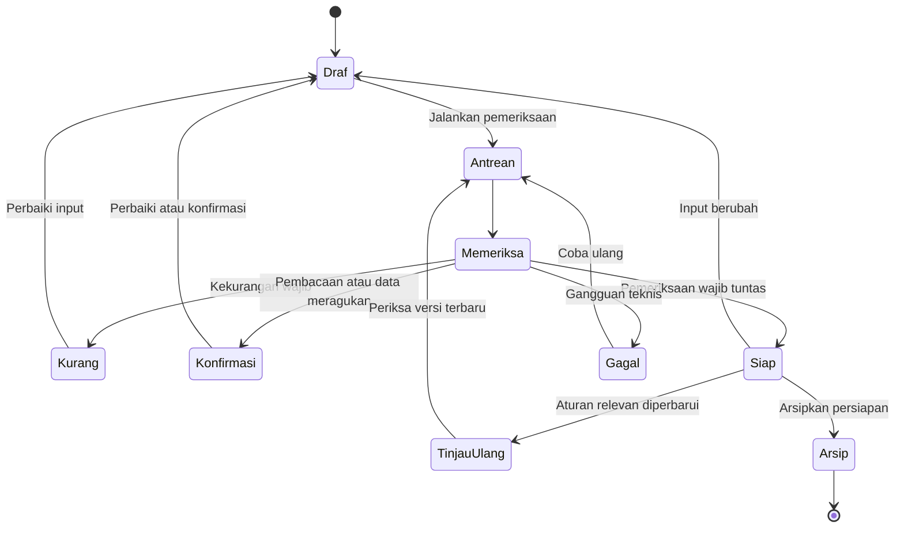

Persiapan yang siap tidak otomatis berubah menjadi pengajuan diterima. Pengajuan memiliki catatan dan sumber status tersendiri.

## 11. Alur website menyeluruh

### 11.1 Warga baru

1. Membuka landing page.
2. Memilih wilayah dan mencari layanan.
3. Membaca panduan serta sumber.
4. Menjawab pertanyaan kondisi tanpa data pribadi.
5. Menekan Mulai Persiapan Berkas.
6. Masuk/daftar; konteks nonpribadi dipertahankan.
7. Mengisi data dan mengunggah dokumen setelah penjelasan penggunaan data.
8. Menjalankan pemeriksaan AI dari tombol di halaman.
9. Meninjau temuan dan melakukan perbaikan.
10. Memeriksa ulang hingga siap atau memilih konfirmasi ke instansi.
11. Membaca ringkasan dan membuka kanal resmi.
12. Mengajukan melalui kanal tersebut.
13. Kembali dan mencatat nomor/tanggal pengajuan jika tersedia.
14. Memantau sesuai sumber pembaruan dan melakukan tindak lanjut.
15. Mengonfirmasi penerimaan hasil dan mengelola penghapusan dokumen.

### 11.2 Warga yang kembali

1. Masuk melalui navigasi atau membuka tautan pribadi.
2. Kembali ke tujuan awal atau dashboard.
3. Membuka draf, hasil AI, atau pengajuan.
4. Menjalankan tindakan yang belum selesai tanpa mengulang pencarian.

### 11.3 Pengunjung yang hanya membutuhkan informasi

Pengunjung boleh berhenti setelah membaca panduan atau langsung membuka kanal pemerintah. Tidak ada kewajiban membuat akun, mengunggah dokumen, atau menggunakan AI untuk memperoleh informasi publik.

## 12. Flowchart website

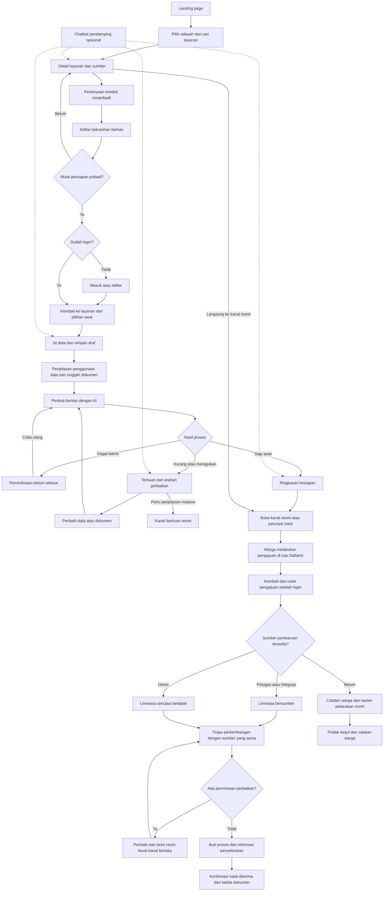

Panah putus-putus menunjukkan bantuan opsional. Cabang petugas, integrasi, dan simulasi merupakan mode sumber status; implementasi tidak boleh mencampurkannya tanpa label. Setelah revisi, warga kembali meninjau pembaruan dengan sumber yang sama. Pengiriman revisi tidak otomatis menghasilkan pembaruan status baru.

## 13. User Flow Diagram — UFD

### 13.1 UFD pengunjung menuju persiapan warga

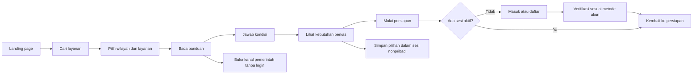

### 13.2 UFD pemeriksaan dan revisi warga

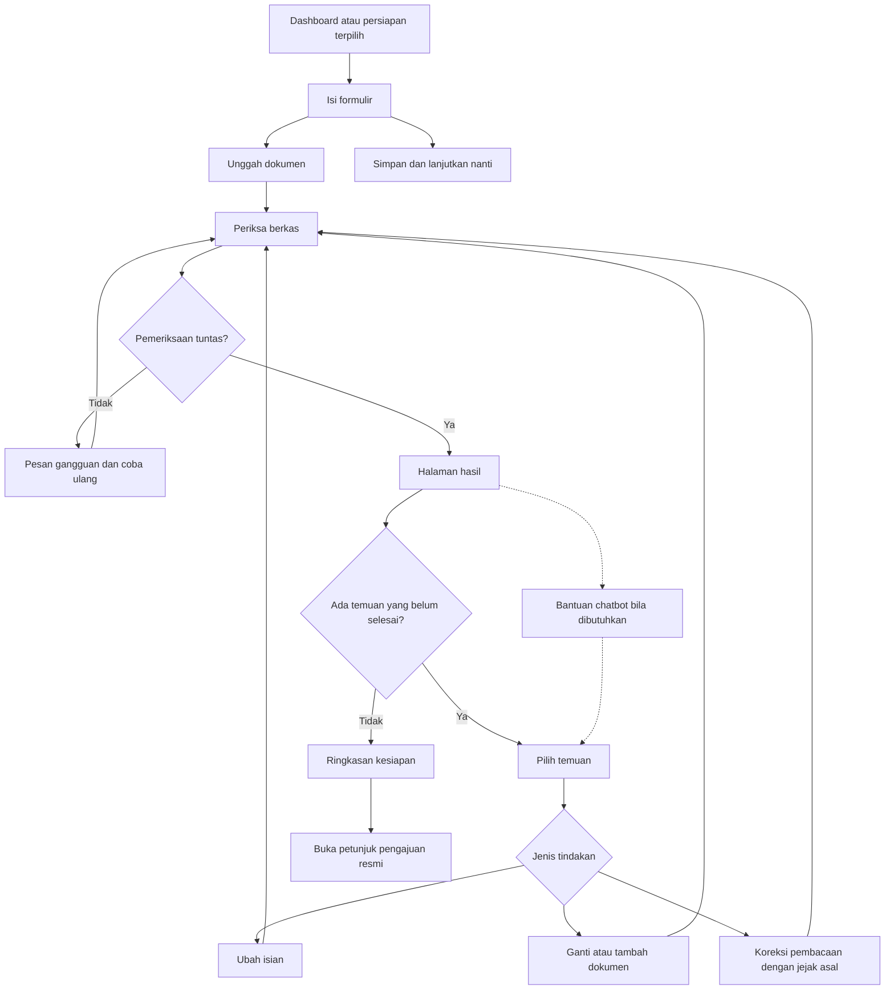

### 13.3 UFD pencatatan dan pelacakan warga

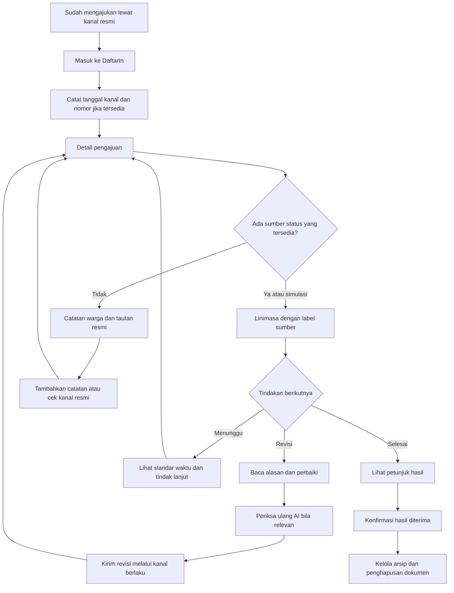

### 13.4 UFD petugas

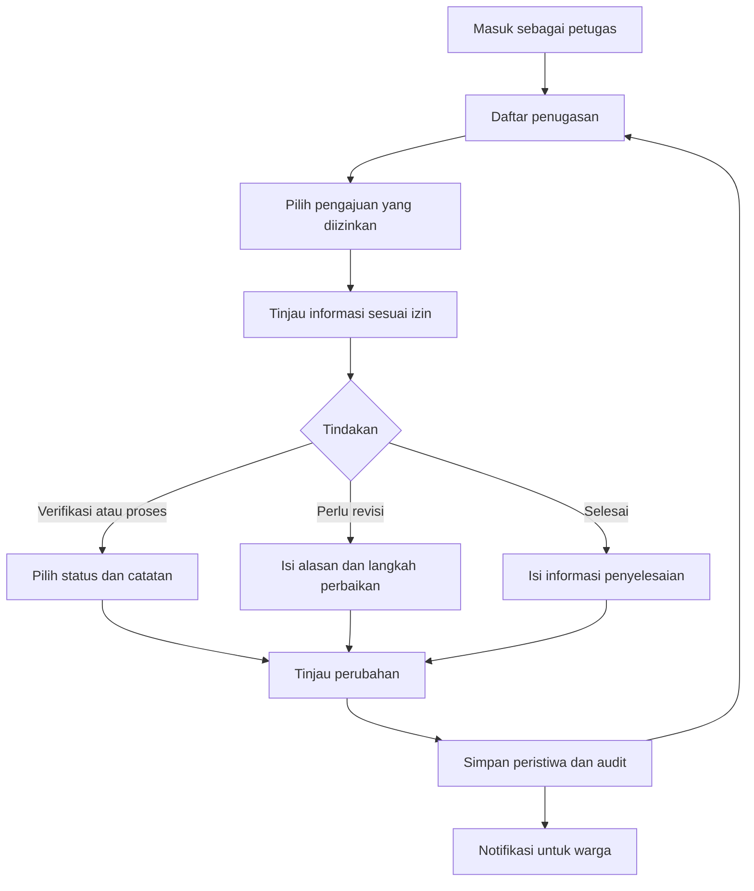

### 13.5 UFD admin

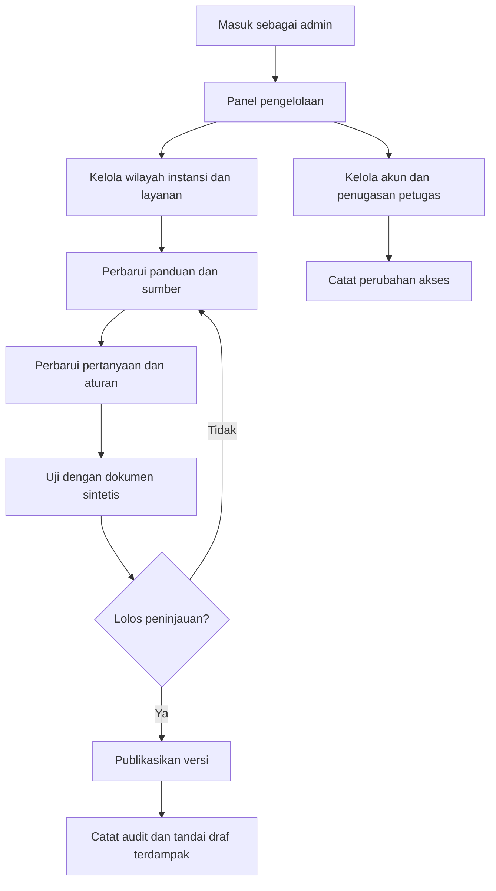

## 14. Data Flow Diagram — DFD

### 14.1 Notasi dan batas sistem

- **Entitas eksternal:** pengunjung/warga, petugas, admin, dan layanan pemrosesan AI.
- **Proses:** fungsi yang menerima, mengolah, atau menghasilkan data.
- **Penyimpanan:** data yang dikelola DaftarIn.
- **Panah:** perpindahan data, bukan urutan klik.
- Portal pemerintah berada di luar sistem. Dalam baseline tanpa integrasi, browser hanya membuka tautan; tidak ada aliran dokumen atau status otomatis antara backend DaftarIn dan portal pemerintah.
- Layanan OCR/LLM ditampilkan sebagai entitas eksternal secara logis. Bila dijalankan sendiri, penempatannya dapat berubah tanpa mengubah kebutuhan produknya.

### 14.2 DFD konteks — proses tunggal

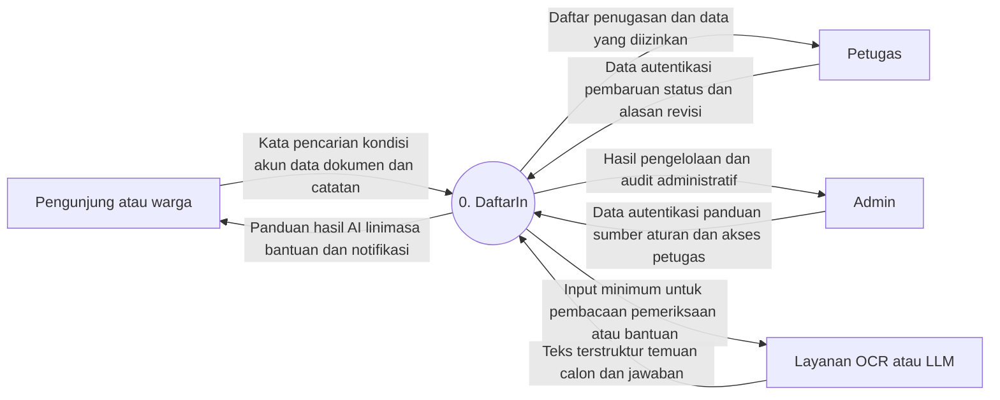

Tidak ada panah ke sistem pemerintah dalam DFD konteks ini karena baseline belum memiliki integrasi. Nomor dan kabar yang dicatat warga masuk melalui entitas warga. Status manual masuk melalui entitas petugas; pada demonstrasi sumbernya dilabeli simulasi.

### 14.3 DFD level 1

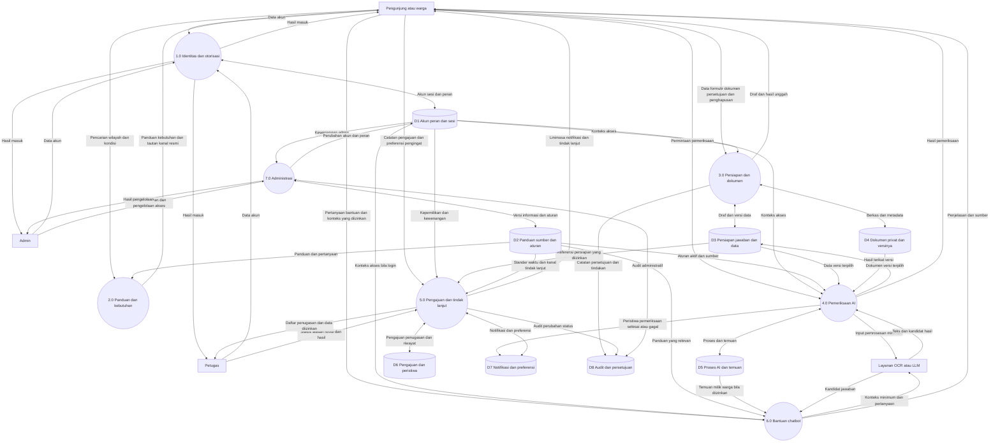

Aliran konteks dipecah menjadi tujuh proses: input warga menuju 1.0–6.0, input petugas menuju 1.0 dan 5.0, input admin menuju 1.0 dan 7.0, serta pertukaran AI menuju 4.0 dan 6.0. Penyimpanan tidak berkomunikasi langsung dengan entitas eksternal. Pemeriksaan otorisasi wajib pada setiap proses terlindungi, termasuk pembacaan file dan perubahan aturan; diagram merangkum detail pengulangan pemeriksaan tersebut.

### 14.4 DFD level 2 — dekomposisi proses 4.0

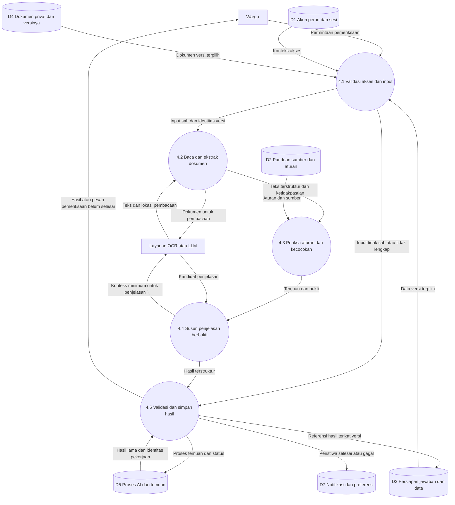

Jika akses ditolak, keluaran hanya berupa pesan penolakan; hasil pribadi tidak dibaca atau ditulis untuk pemohon yang tidak berhak. Status proses untuk akses yang sah tetap dapat merekam kegagalan teknis. Batas input/output proses 4.0 pada level 1 dipertahankan pada level 2.

### 14.5 Alur kanal pemerintah di luar DFD baseline

1. DaftarIn memberikan tautan/petunjuk resmi kepada browser warga.
2. Warga membuka kanal pemerintah secara terpisah.
3. Warga melakukan autentikasi dan pengajuan sesuai aturan kanal tersebut.
4. Warga kembali dan mencatat informasi pengajuan.

Integrasi masa depan harus menambahkan entitas pemerintah, kontrak data, otorisasi, mekanisme sinkronisasi, dan penanganan kegagalan ke DFD. Integrasi tersebut tidak diasumsikan oleh dokumen ini.

## 15. Model data konseptual

Nama berikut adalah entitas konseptual, bukan keputusan struktur database final.

| Entitas | Atribut utama | Relasi/batas penting |
| --- | --- | --- |
| User | ID, nama tampilan, kontak autentikasi, status verifikasi | Memiliki persiapan dan pengajuan |
| Role/Assignment | Pengguna, peran, cakupan instansi/wilayah, masa aktif | Tidak berasal dari pilihan bebas pada daftar publik |
| Region | ID, nama, jenis wilayah, induk | Menghubungkan layanan ke cakupan |
| Agency | ID, nama, wilayah, kanal | Tidak menyiratkan kerja sama resmi |
| Service | ID, nama, kategori, instansi, status publikasi | Memiliki versi panduan |
| GuideVersion | Versi, prosedur, biaya, waktu, tanggal peninjauan | Tidak ditimpa oleh pembaruan berikutnya |
| OfficialSource | URL, judul, penerbit, tanggal sumber/akses | Mendukung bagian informasi tertentu |
| Requirement/RuleVersion | Dokumen/isian wajib, kondisi, aturan, sumber | Menjadi snapshot dasar pemeriksaan |
| Preparation | ID internal, pemilik, layanan, versi panduan, status | Bukan pengajuan resmi |
| Answer/DataVersion | Pertanyaan, jawaban, asal nilai, versi | Perubahan memicu kebutuhan pemeriksaan baru |
| DocumentVersion | Pemilik, persiapan, jenis, lokasi privat, tipe, ukuran, hash, versi | Kontrol akses dan kebijakan penghapusan |
| ConsentRecord | Tujuan, versi pemberitahuan, waktu, akun | Persetujuan terpisah dari hasil pemeriksaan |
| InspectionRun | ID, input versi, aturan, model/konfigurasi, status, waktu | Satu proses mengacu pada snapshot input |
| Finding | Kategori, bukti, dasar aturan, tindakan, kepastian, status | Terhubung ke proses dan versi dokumen |
| UserCorrection | Nilai awal, koreksi, penulis, waktu | Tidak dianggap pembuktian resmi |
| ApplicationRecord | Pemilik, layanan, persiapan opsional, nomor resmi opsional, tanggal, kanal | Sumber pencatatan dan mode nyata/simulasi wajib |
| StatusEvent | Pengajuan, status, sumber, waktu kejadian, waktu dicatat, catatan | Riwayat berurutan dan audit koreksi |
| OfficerAssignment | Petugas, pengajuan, cakupan izin | Tidak otomatis membuka seluruh draf |
| Notification | Pemilik, jenis, referensi, waktu, status baca | Tanpa isi dokumen sensitif |
| ReminderPreference | Pengguna, pengajuan, jadwal/pemicu, kanal | Tidak menjadi sumber status |
| AuditEvent | Aktor, tindakan, objek, waktu, hasil | Hindari pencatatan isi dokumen/identitas lengkap |

### 15.1 Relasi inti

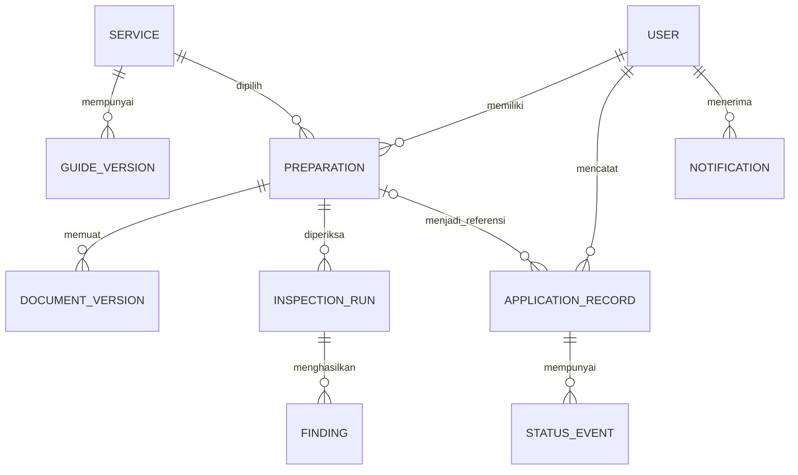

Pengajuan boleh dicatat tanpa persiapan AI sebelumnya. Relasi persiapan pada catatan pengajuan bersifat opsional. Dokumen hasil resmi tidak otomatis disalin dari portal pemerintah.

## 16. Kebutuhan nonfungsional

### 16.1 Pengalaman dan aksesibilitas

- Responsif untuk ponsel dan desktop; alur unggah nyaman pada ponsel.
- Navigasi keyboard, label formulir jelas, fokus terlihat, dan pesan kesalahan terkait kolom.
- Status tidak dibedakan melalui warna saja; gunakan teks dan ikon pendukung.
- Progres, keadaan kosong, pemuatan, kegagalan, dan keberhasilan tersedia pada setiap modul.
- Bahasa sederhana; istilah resmi disertai penjelasan jika perlu.
- Chatbot tidak menutup tombol penting atau menjadi satu-satunya jalur bantuan.
- Dukungan pembaca layar perlu diuji pada formulir, unggahan, dan temuan.

### 16.2 Keamanan akses

- Otorisasi diperiksa di server pada setiap pembacaan/perubahan sumber daya pribadi.
- Koneksi terenkripsi dan penyimpanan dokumen terlindungi.
- Berkas disajikan melalui akses terotorisasi dengan masa berlaku terbatas bila memakai tautan sementara.
- Kredensial penyedia AI tidak dikirim ke browser.
- Sesi, pemulihan akun, percobaan login, dan penggunaan AI memiliki kontrol penyalahgunaan.
- Tautan kembali setelah login dibatasi ke tujuan aplikasi yang sah.
- Preview dokumen tidak mengeksekusi konten aktif yang berasal dari unggahan.

### 16.3 Keandalan proses

- Pemeriksaan AI berjalan sebagai pekerjaan yang tidak hilang saat halaman ditutup.
- Menekan tombol berulang tidak membuat proses identik berbayar berkali-kali.
- Hasil dari proses lama tidak menimpa versi dokumen baru.
- Kegagalan penyedia menghasilkan keadaan dapat dicoba ulang.
- Pembaruan status dan notifikasi memiliki pencegahan duplikasi.
- Waktu kejadian disimpan konsisten dan ditampilkan dengan zona waktu yang jelas.

### 16.4 Kinerja dan kapasitas

Target angka belum ditetapkan karena penyedia, anggaran, ukuran berkas, dan jumlah pengguna belum dipilih. Sebelum implementasi, tetapkan batas unggahan, waktu tunggu, kuota AI, jumlah pemeriksaan serentak, dan target waktu muat.

Penerimaan minimum: halaman selalu menunjukkan apakah permintaan tersimpan, sedang diproses, berhasil, atau gagal; tidak ada penantian tanpa status. Jalur katalog dan panduan tetap berfungsi saat AI tidak tersedia.

## 17. Privasi dan pengelolaan dokumen

### 17.1 Pengumpulan dan penggunaan

- Minta data minimum yang diperlukan untuk layanan dan pemeriksaan yang dipilih.
- Jelaskan tujuan sebelum unggah, termasuk jika penyedia eksternal memproses isi dokumen.
- Jangan memakai dokumen warga sebagai materi demonstrasi atau data pelatihan tanpa dasar dan persetujuan terpisah yang sesuai.
- Jika ketentuan penyedia dan pengelolaan data belum jelas, batasi demonstrasi ke dokumen sintetis.
- Petugas hanya menerima data melalui alur berbagi/penugasan yang ditetapkan; bukan seluruh isi ruang pribadi warga.

### 17.2 Penyimpanan dan penghapusan

| Jenis data | Kebutuhan kebijakan |
| --- | --- |
| Dokumen mentah | Tentukan masa simpan dan pilihan hapus |
| Teks OCR dan data hasil ekstraksi | Mengikuti sensitivitas dokumen asal; jangan tertinggal setelah penghapusan tanpa alasan yang ditetapkan |
| Hasil AI dan koreksi | Terhubung ke aturan retensi persiapan dan hak akses yang sama |
| Percakapan bantuan | Penyimpanan permanen bukan kebutuhan wajib; jika disimpan harus dijelaskan |
| Catatan status | Masa simpan ditetapkan terpisah dari berkas mentah sesuai kebutuhan operasional |
| Cadangan | Jadwal penghapusan efektif dari cadangan harus dijelaskan |
| Audit | Hindari isi dokumen; retensi dan akses dibatasi |

Penghapusan dokumen harus mengidentifikasi salinan mentah, pratinjau, teks ekstraksi, dan konteks yang tersimpan. Jika proses penghapusan bertahap, pengguna diberi status dan keterangan penyelesaiannya. Kebijakan ini harus konkret sebelum menerima dokumen pribadi sungguhan.

### 17.3 Mode simulasi

- Memakai nama, identitas, berkas, dan nomor pengajuan sintetis.
- Label simulasi terlihat pada data dan hasil, bukan hanya pada halaman depan.
- Lingkungan demonstrasi dipisahkan dari data pribadi nyata jika versi operasional tersedia.
- Tidak memakai identitas visual yang membuat pengguna mengira produk adalah portal resmi pemerintah.

## 18. Keadaan khusus dan penanganan kegagalan

| Keadaan | Perilaku yang diharapkan |
| --- | --- |
| Wilayah atau layanan belum tersedia | Jelaskan cakupan, tawarkan pilihan lain tanpa mengasumsikan aturan wilayah lain |
| Sumber resmi tidak dapat diakses | Tampilkan informasi terakhir beserta tanggal dan keadaan perlu peninjauan |
| Sumber saling berbeda | Tandai konflik dan minta pengelola meninjau; jangan memilih dasar wajib secara diam-diam |
| Login gagal/sesi habis | Jelaskan tindakan, kembali ke tujuan setelah autentikasi berhasil |
| File terlalu besar atau tidak didukung | Tolak dengan batas yang jelas, pertahankan isian lain |
| Foto buram/halaman terpotong | Tunjukkan bagian yang perlu diunggah ulang |
| AI tidak yakin jenis dokumen | Minta konfirmasi/unggahan lebih jelas; jangan menganggap cocok |
| Dokumen berisi instruksi kepada AI | Abaikan sebagai instruksi; perlakukan sebagai isi dokumen |
| Layanan AI tidak tersedia | Status belum selesai dan coba ulang; panduan tetap tersedia |
| Dokumen berubah saat proses berjalan | Simpan hasil pada versi lama dan minta pemeriksaan versi baru |
| Aturan layanan diperbarui | Beri informasi bahwa hasil lama memakai aturan terdahulu |
| Warga tidak memiliki nomor resmi | Simpan catatan pengajuan dengan keterangan nomor belum tersedia |
| Nomor resmi belum dapat diverifikasi | Label dicatat warga; tidak mengaku terhubung ke instansi |
| Tidak ada sumber status | Tampilkan catatan dan kanal resmi, bukan linimasa otomatis palsu |
| Waktu layanan belum jelas | Tidak membuat estimasi atau tenggat resmi sendiri |
| Perubahan status salah | Tambah koreksi audit, jangan menghapus jejak tanpa catatan |
| Akun mencoba data orang lain | Tolak akses tanpa membocorkan isi atau keberadaan detail sensitif |
| Chatbot gagal | Bantuan statis dan seluruh formulir utama tetap dapat digunakan |

## 19. Kriteria penerimaan dan skenario pengujian

Kriteria berikut menjadi dasar pengujian penerimaan. Bukan pernyataan bahwa implementasi atau pengujian sudah dilakukan.

| ID | Skenario | Hasil yang harus terjadi |
| --- | --- | --- |
| AC-01 | Pengunjung membuka website | Landing page, katalog, dan panduan dapat dibaca tanpa login |
| AC-02 | Pengunjung mencari layanan wilayah tertentu | Hasil sesuai cakupan dan sumber wilayah |
| AC-03 | Pengunjung mulai unggah dokumen pribadi | Diminta login sebelum file diproses/disimpan |
| AC-04 | Warga selesai login dari persiapan | Kembali ke layanan dan jawaban nonpribadi yang sama |
| AC-05 | Warga A meminta berkas Warga B | Server menolak akses meskipun ID/URL diketahui |
| AC-06 | Warga menjalankan seluruh persiapan tanpa chatbot | Proses dapat diselesaikan melalui halaman |
| AC-07 | Dokumen wajib belum ada | Temuan kelengkapan dengan dasar aturan dan tindakan |
| AC-08 | Teks penting buram | Perlu pemeriksaan ulang, tidak diberi status siap |
| AC-09 | Nilai data berbeda antarberkas | Perbedaan ditunjukkan, bukan tuduhan dokumen palsu |
| AC-10 | Warga mengoreksi OCR | Asal koreksi tersimpan sebagai koreksi pengguna |
| AC-11 | Dokumen diganti setelah hasil siap | Hasil lama ditandai tidak berlaku bagi versi terbaru |
| AC-12 | AI gagal sebelum pemeriksaan tuntas | Status pemeriksaan belum selesai dan tersedia coba ulang |
| AC-13 | Warga klik periksa berkali-kali | Tidak menghasilkan pekerjaan identik tak terkendali |
| AC-14 | Ringkasan siap ditampilkan | Ada batas pemeriksaan dan tidak mengklaim persetujuan resmi |
| AC-15 | Warga membuka kanal resmi | Tidak dinyatakan sudah mengajukan dan tidak ada transfer dokumen tersembunyi |
| AC-16 | Warga mencatat nomor pengajuan | Label dicatat warga dan nomor internal tetap terpisah |
| AC-17 | Tidak ada petugas/integrasi | Tidak muncul status instansi buatan |
| AC-18 | Petugas membuat permintaan revisi | Alasan dan langkah perbaikan wajib terisi |
| AC-19 | Petugas membuka draf tidak ditugaskan | Akses ditolak |
| AC-20 | Admin menerbitkan aturan baru | Versi baru tersimpan; hasil lama tetap mengacu versi sebelumnya |
| AC-21 | Notifikasi hanya pengingat | Tidak diberi teks seolah status instansi berubah |
| AC-22 | Demo berjalan | Label simulasi muncul pada dokumen/pengajuan/linimasa terkait |
| AC-23 | Warga menghapus dokumen | Akses dicabut dan seluruh turunan mengikuti kebijakan penghapusan |
| AC-24 | Chatbot diminta mengubah status | Chatbot tidak melakukannya dan mengarahkan ke halaman yang berwenang |
| AC-25 | PDF berisi perintah mengabaikan aturan | Pemeriksaan tidak mengikuti perintah di dokumen |
| AC-26 | Pengguna memakai keyboard/layar kecil | Formulir dan tindakan inti tetap dapat dioperasikan |
| AC-27 | Catatan pengajuan dibuat tanpa persiapan AI | Diizinkan, tanpa mengarang hasil kesiapan |
| AC-28 | Pengguna publik mencoba memilih peran admin saat daftar | Peran istimewa tidak diberikan |

### 19.1 Evaluasi kualitas AI

- Siapkan contoh berlabel untuk dokumen lengkap, kurang, buram, jenis salah, perbedaan data, dan variasi tata letak.
- Ukur salah tandai dan masalah yang terlewat per kategori, bukan hanya satu skor gabungan.
- Evaluasi apakah bukti dan arahan perbaikan benar-benar mendukung temuan.
- Sertakan kasus ketidakpastian; sistem harus mampu menyatakan belum dapat memastikan.
- Tetapkan ambang kualitas bersama tim sebelum mengaktifkan pemeriksaan pada dokumen sungguhan.
- Perubahan model, aturan, atau prompt yang memengaruhi hasil perlu dievaluasi ulang pada kumpulan contoh yang sama.

## 20. Pengukuran keberhasilan

Target angka ditetapkan setelah cakupan dan baseline uji tersedia. Tidak ada klaim penurunan revisi sebelum evaluasi nyata.

| Metrik | Definisi |
| --- | --- |
| Keberhasilan menemukan layanan | Proporsi peserta uji yang menemukan layanan tepat tanpa bantuan fasilitator |
| Penyelesaian persiapan | Persiapan yang mencapai hasil akhir dibanding persiapan yang dimulai |
| Penyelesaian temuan | Temuan yang diperbaiki pada versi berikutnya dibanding temuan yang dapat ditindaklanjuti |
| Ketepatan temuan AI | Temuan yang dinilai benar pada sampel berlabel dibanding seluruh temuan yang dinilai |
| Masalah terlewat | Masalah berlabel yang tidak ditemukan sistem menurut kategori |
| Kegagalan pemeriksaan | Proses gagal teknis dibanding total proses |
| Waktu pemeriksaan | Distribusi waktu dari pekerjaan diterima sampai hasil tersedia |
| Pemahaman sumber status | Peserta dapat membedakan catatan warga, petugas, dan simulasi |
| Pemahaman langkah berikutnya | Peserta dapat menyebutkan tindakan setelah membaca hasil/linimasa |
| Revisi resmi setelah bantuan | Hanya dapat diukur jika ada data tindak lanjut yang sah dan pembanding memadai |

Analitik tidak boleh merekam isi dokumen, nilai identitas lengkap, atau teks percakapan sensitif sebagai peristiwa umum.

## 21. Prioritas implementasi

Prioritas ini adalah usulan pelaksanaan, bukan keputusan cakupan lomba final.

| Prioritas | Lingkup | Alasan |
| --- | --- | --- |
| P0 — Inti | Landing page, katalog/panduan bersumber, pertanyaan kebutuhan, autentikasi, dashboard, persiapan, unggah, pemeriksaan AI, hasil/revisi, kanal resmi, pencatatan pengajuan | Membentuk perjalanan utama |
| P0 — Kejujuran pelacakan | Linimasa bersumber, pemisahan nomor/status, mode simulasi bila digunakan | Menjaga fokus Public Service Tracking dan mencegah salah pengertian |
| P0 — Pengelolaan | Panduan/aturan berversi, pembatasan akses, petugas simulasi bila diperlukan demonstrasi | Membuat data dan pembaruan dapat dikelola |
| P1 — Pendamping | Chatbot kontekstual, notifikasi dalam aplikasi, pengingat pilihan warga | Membantu penggunaan setelah alur inti utuh |
| P2 — Pengembangan | Email/push, integrasi resmi, perluasan wilayah/layanan, analitik agregat | Memerlukan kebutuhan, akses, atau sumber daya tambahan |

Chatbot tetap termasuk rancangan produk lengkap meskipun urutan pembangunannya setelah alur utama. Penggunaan dokumen pribadi nyata baru dibuka setelah pengelolaan data dan kesiapan operasional ditetapkan.

## 22. Rencana demonstrasi lomba

### 22.1 Skenario end-to-end yang diusulkan

1. Pengunjung membuka landing page dan menemukan satu layanan contoh.
2. Pengunjung membaca sumber dan menjawab kondisi.
3. Pengunjung login, kembali ke konteks awal, lalu mengisi data sintetis.
4. Warga mengunggah dokumen contoh dengan satu kekurangan dan satu perbedaan data.
5. Pemeriksaan AI menampilkan temuan dan bukti yang dapat ditindaklanjuti.
6. Warga memperbaiki, memeriksa ulang, dan melihat hasil siap berdasarkan pemeriksaan awal.
7. Website menunjukkan langkah kanal resmi tanpa mengklaim mengirim pengajuan.
8. Akun warga mencatat pengajuan simulasi.
9. Akun petugas simulasi memperbarui status dan meminta revisi/menyelesaikan proses.
10. Warga melihat pembaruan bersumber serta informasi hasil.
11. Chatbot diperagakan singkat hanya ketika warga meminta penjelasan salah satu temuan.

### 22.2 Kejujuran demo

- Bedakan pemeriksaan AI sungguhan terhadap dokumen sintetis dengan hasil yang dipersiapkan sebelumnya.
- Jika suatu komponen hanya berupa simulasi tampilan, beri label demonstrasi dan jangan menyebutnya telah berfungsi penuh.
- Jangan menampilkan tombol atau pesan yang menyatakan terhubung ke pemerintah jika belum ada koneksi resmi.

## 23. Ketergantungan dan risiko

| Ketergantungan/risiko | Implikasi | Respons |
| --- | --- | --- |
| Pemilihan layanan belum final | Aturan dan formulir belum dapat dikunci | Tentukan cakupan pilot sebelum implementasi aturan |
| Sumber tidak lengkap atau berubah | Hasil pemeriksaan bisa tidak relevan | Versi sumber, peninjauan, dan penanganan konflik |
| LLM/OCR salah membaca | Temuan keliru atau masalah terlewat | Bukti, ketidakpastian, koreksi, dan evaluasi berlabel |
| Dokumen pribadi sensitif | Membutuhkan pengelolaan yang konkret | Minimalisasi, izin, akses privat, retensi dan penghapusan |
| Biaya/latensi AI | Waktu tunggu atau penggunaan tidak terkendali | Kuota, batas input, antrean, dan pencegahan duplikasi |
| Tidak ada integrasi pemerintah | Tidak ada pembaruan status otomatis | Catatan warga, kanal resmi, petugas/simulasi berlabel |
| Informasi siap disalahartikan sebagai diterima | Harapan pengguna keliru | Bahasa status konsisten dan pemisahan tahap |
| Sumber status tercampur | Pengguna mengira catatan pribadi adalah konfirmasi instansi | Label sumber di setiap peristiwa |
| Fitur terlalu luas untuk tenggat | Inti produk tidak selesai | Fokus satu cakupan pilot setelah diputuskan |

## 24. Keputusan yang masih diperlukan

Daftar ini tidak menghalangi penggunaan PRD sebagai rancangan produk. Isinya menentukan konfigurasi, cakupan pembangunan, dan kelayakan penggunaan nyata.

| ID | Keputusan | Mengapa diperlukan | Batas sebelum diputuskan |
| --- | --- | --- | --- |
| OD-01 | Aturan, hasil wajib, dan tenggat lomba | Menentukan prioritas dan kedalaman implementasi | Belum ada jadwal pembangunan final |
| OD-02 | Prototipe, uji bersama instansi, atau layanan nyata | Menentukan kesiapan operasional | Jangan menyebut produk operasional pemerintah |
| OD-03 | Wilayah, instansi, dan layanan pilot | Menentukan sumber dan aturan | Contoh Disdukcapil/tiga layanan belum menjadi keputusan |
| OD-04 | Dokumen sintetis saja atau dokumen pribadi | Menentukan pengelolaan data | Utamakan sintetis sampai ketentuan nyata ditetapkan |
| OD-05 | Metode login dan pemulihan | Menentukan layanan identitas | Email/kata sandi masih usulan |
| OD-06 | Penyedia OCR/LLM dan ketentuan datanya | Menentukan kemampuan, biaya, dan penggunaan dokumen | Tidak mengirim dokumen pribadi tanpa kejelasan |
| OD-07 | Masa simpan, penghapusan, dan cadangan | Menghindari retensi tanpa batas | Tetapkan sebelum unggahan pribadi nyata |
| OD-08 | Batas ukuran, format, halaman, dan kuota AI | Menentukan kapasitas serta pengalaman | Jangan menjanjikan unggahan/pemeriksaan tanpa batas |
| OD-09 | Petugas nyata atau akun simulasi | Menentukan sumber status | Label simulasi jika belum ada penugasan resmi |
| OD-10 | Cara pengaitan dan pembagian data ke petugas | Menentukan hak akses operasional | Draf tetap pribadi secara bawaan |
| OD-11 | Kanal notifikasi tambahan | Menentukan integrasi dan biaya | Baseline notifikasi dalam aplikasi |
| OD-12 | Teknologi, anggaran, tim, hosting | Menentukan rencana teknis | Tidak mengunci stack dalam PRD |
| OD-13 | Ambang evaluasi AI dan target kinerja | Menentukan kelayakan rilis | Belum ada klaim akurasi atau kecepatan tertentu |
| OD-14 | Tagline dan identitas visual | Menentukan komunikasi produk | Nama DaftarIn sudah dipilih; tagline masih usulan |

## 25. Glosarium

| Istilah | Arti dalam DaftarIn |
| --- | --- |
| Landing page | Halaman publik pembuka yang menjelaskan produk dan mengarahkan ke layanan |
| Autentikasi/auth | Proses membuktikan identitas akun |
| Otorisasi | Pemeriksaan apakah akun berhak membaca atau mengubah objek tertentu |
| Persiapan | Ruang pribadi untuk data, dokumen, dan pemeriksaan sebelum pengajuan |
| Pemeriksaan awal AI | Bantuan otomatis menemukan masalah yang dapat dideteksi; bukan keputusan instansi |
| OCR | Pembacaan teks dari gambar atau dokumen |
| LLM | Model bahasa untuk membantu interpretasi dan penjelasan dalam batas aturan |
| Temuan | Masalah atau ketidakpastian yang perlu ditindaklanjuti |
| Pengajuan resmi | Permohonan yang dilakukan melalui kanal yang berlaku pada instansi |
| Catatan warga | Informasi yang dimasukkan sendiri oleh warga dan belum tentu dikonfirmasi instansi |
| Sumber status | Pihak atau mekanisme yang menghasilkan informasi perkembangan |
| Standar waktu resmi | Waktu layanan berdasarkan sumber instansi beserta dasar penghitungannya |
| Estimasi | Perkiraan yang harus diberi label terpisah dari standar resmi |
| Simulasi | Data/proses demonstrasi yang tidak mewakili pengajuan pemerintah nyata |
| UFD | Diagram perjalanan pengguna melalui layar dan keputusan |
| DFD | Diagram perpindahan data antara entitas, proses, dan penyimpanan |

---

**Batas akhir rancangan:** JejakMasWowo membantu warga memahami, menyiapkan, memeriksa, dan mengikuti pengurusan. Halaman interaktif menjadi pusat pengalaman; chatbot menjadi pendamping. Kewenangan keputusan resmi tetap pada instansi, dan kemampuan pelacakan selalu mengikuti sumber pembaruan yang benar-benar tersedia.
